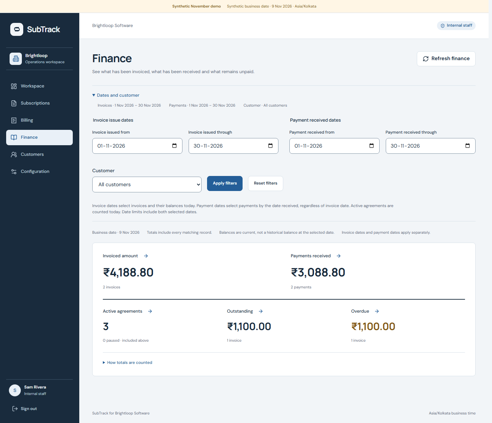
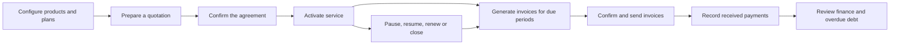
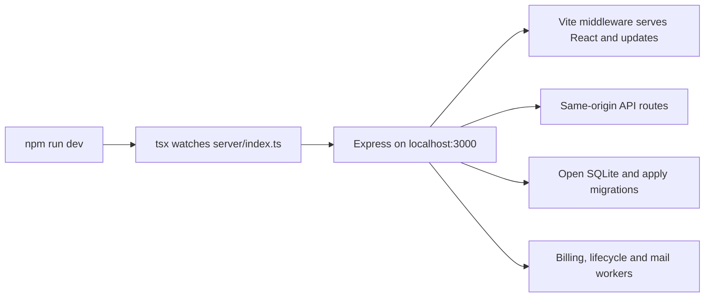

# SubTrack

**From the first quotation to the final payment, with every agreement accounted for.**

SubTrack is Brightloop Software’s subscription management system: one connected workspace for catalog configuration, quotations, service changes, recurring invoices, collections and finance. Every amount, record and next action comes from persisted business data.

## Start the application with one command

Requires **Node.js 24+** and npm; verified on Windows with Node **26.8.1**. After the [one-time setup](#one-time-setup), daily startup is:

```sh
npm run dev
```

Open **[localhost:3000](http://localhost:3000)**. One terminal starts the Express backend and the React interface through Vite middleware. Startup opens the local database and applies migrations automatically. No separate frontend/backend command or nodemon process is needed. Stop with **Ctrl+C**.

## Try the complete local demo

For a populated walkthrough, use this separate, isolated demo. No Docker, hosted database, `.env`, SMTP account or model API is needed.

```sh
npm ci
npm run build
npm run demo
```

Open **[localhost:3003](http://localhost:3003)**. Sign in with **`Brightloop!2026`**:

- **Administrator:** `admin@brightloop.test` — configure offerings, manage staff and run the full workflow.
- **Internal staff:** `staff@brightloop.test` — prepare agreements, bill, record collections and inspect finance.
- **Customer portals:** `studio@brightloop.test`, `shop@brightloop.test`, `services@brightloop.test` — access each customer’s own agreements, invoices, payments and permitted service changes.

The labelled synthetic demo uses **9 November 2026**. Its default settled scenario shows **3 active agreements**, **₹4,188.80 invoiced**, **₹3,088.80 received** and **₹1,100 outstanding and overdue**, with November invoice/payment filters. The first customer’s two payments reconcile to its Paid invoice; the second remains collectible.

To demonstrate collection yourself:

```sh
npm run demo -- --settlement=unpaid
npm run demo -- --settlement=partial
```

Run one scenario at a time; stop it with **Ctrl+C**. Each launch creates a fresh, retained `data/november-demo-*.sqlite` database. Existing databases stay intact. Use `--port=3004` for another port. The demo never reads `.env`, sends real email or moves money. Follow the [judge walkthrough](docs/JUDGE_WALKTHROUGH.md) for the complete sequence.

## What you can do

- **Configure real offerings.** Products include sales/cost prices, internal notes and variant adjustments. Plans support daily, weekly, monthly and yearly billing, minimum quantities, availability dates and lifecycle permissions.
- **Quote once, reuse the structure.** Templates carry plans, product lines and validity. Every subscription instance receives its own reference, customer, service term, payment terms and price breakdown.
- **Keep agreed prices traceable.** Move through Draft → Quotation → Confirmed → Active → Closed. Issuing freezes offered terms; confirmation preserves the accepted agreement through later catalog changes.
- **Bill the backlog safely.** Persisted, bounded billing runs show progress, created/existing/non-billable/failed outcomes and remaining work. Retry failed periods without duplicating their logical charges.
- **Calculate money exactly.** Integer minor units, explicit rounding, plan-price substitution and variant adjustments keep totals deterministic. Taxes apply after the selected discount.
- **Control discount eligibility and usage.** Fixed or percentage rules support product/subscription scope, thresholds, inclusive validity, priority and usage limits. Draft reservations and confirmation consumption are atomic.
- **Collect partial payments correctly.** Review amount, method, date and internal note before recording. Partial settlement keeps an invoice Confirmed; the balance reaches zero before Paid. Zero-total invoices settle without fake payments. Replays and concurrent allocations cannot double-record or overpay.
- **Manage service on real billing boundaries.** Plan-permitted pause, resume, renewal, early closure, expiry and optional-line changes preserve dated history and earlier debt. Paused full periods receive explicit non-billable outcomes.
- **Reconcile finance and customer access.** Separate invoice-issue and payment-received date ranges, current outstanding/overdue balances and whole-filter totals connect to paginated records. Customers see only their own data; internal costs and payment notes stay out of portal payloads.
- **Finish the invoice workflow.** Confirm, cancel, review a linked replacement, send a controlled email notice, and open an authenticated print/Save as PDF view. Delivery states distinguish local generation, SMTP acceptance, failure and uncertainty.
- **Use optional AI without handing it authority.** Request catalog-grounded selections, review and Apply them, inspect the normal calculated estimate, then explicitly Save draft. Manual entry remains complete when AI is disabled, unavailable or declines a request.



*A working finance sheet, backed by the isolated November demo’s invoices and payment records.*

## Follow an agreement through the business



Workflow diagram reused from the [team working guide](docs/working/README.md#1-what-we-built-and-why).

## One-time setup

The normal application uses the real business clock and a persistent local database. Its defaults are **[localhost:3000](http://localhost:3000)** and `data/subtrack.sqlite`.

Install dependencies once after cloning:

```sh
npm ci
```

Then use **`npm run dev`** for daily startup. Database creation and migrations are automatic; `npm run db:migrate` remains available as an explicit maintenance command. To add synthetic login accounts, optionally run **`npm run db:seed`** once. The additive seed preserves existing records and is never run automatically.

Default local operation does not need `.env`. If you want to customize settings, this optional PowerShell command creates it only when missing:

```powershell
if (-not (Test-Path -LiteralPath .env)) { Copy-Item -LiteralPath .env.example -Destination .env }
```

The guarded copy preserves an existing `.env`. Keep it private and restart the server after changing settings.

Normal seed accounts are `admin@brightloop.test`, `staff@brightloop.test`, `maya@brightloop.test` and `arun@brightloop.test`, all with `Brightloop!2026`. The studio/shop/services accounts belong to the separate November demo. All seeded identities are synthetic.

For the compiled application, after the database setup above:

```sh
npm run build
npm start
```

Both modes bind to `127.0.0.1`. `PORT`, `APP_ORIGIN`, `DATABASE_PATH` and delivery settings are documented in [.env.example](.env.example). Keep the SQLite database on a local persistent disk, with room for its WAL files.

## Verify the build

```sh
npm run check
npx playwright install chromium
npm run test:e2e
```

`check` runs lint, client/server typecheck, domain/integration tests and the production build. Browser tests then use those built assets and a fresh isolated SQLite database on port **3100**, with synthetic email/model transports and no local `.env` credentials.

The verified release passed **181 domain/integration tests** and **30 production-browser journeys**. Coverage includes role/ownership isolation, date and rounding boundaries, discount races, worker retries, payment allocation, response-loss replay, lifecycle history, finance reconciliation and optional AI fallback/review. See the [implementation record](docs/IMPLEMENTATION_STATUS.md), [AI verification](docs/evidence/P9_VERIFICATION.md) and [main integration record](docs/evidence/MAIN_INTEGRATION.md).

### Measured performance

The dedicated fixture contains **10,000 subscriptions, 30,000 invoices, 60,000 invoice lines and 27,400 positive payments**, with all four calendar cadences.

- Complete desktop coverage: **93 destination/role/state variants**, **14 interactions**, and **115 role/API paths**, with **50 warm samples per destination**, plus separate cold and concurrent measurements.
- The original full run retained a **2.647-second cold workbench breach**. Tracing identified queue SQL; corrected affected paths then passed **20 cold navigations and 50 warm samples per queue variant** without a threshold breach.
- Failed and interrupted runs remain in the evidence. This combines complete-inventory coverage with corrected affected-path verification; it is not a claim that every original sample was under two seconds.
- Thousands-row mobile performance was not measured; functional narrow-screen browser tests are separate. Loopback results do not establish production capacity or a universal latency guarantee.

Reproduce the benchmark after building:

```sh
npm run benchmark:seed
npm run benchmark -- --manifest=data/<printed-file>.sqlite.manifest.json --samples=50 --label=release
```

The generator refuses to overwrite an existing file. The runner uses a separate server on port **3004**, isolated database copies and no SMTP/model calls. Allow at least **1.5 GB** of free disk. Read [dataset validation](docs/evidence/P8_DATASET.md) and the [full performance report](docs/evidence/P8_PERFORMANCE.md) for hardware, timing boundaries, results and limitations.

## Email and printable invoices

The default **`MAIL_MODE=outbox`** generates local records; it does not prove inbox delivery. SMTP is optional and uses approved test recipients configured through `MAIL_ALLOWED_RECIPIENTS`. Observed reset/invoice delivery and rendered PDFs are recorded in [reset delivery evidence](docs/evidence/P1_DELIVERY.md) and [invoice delivery/print evidence](docs/evidence/P5_DELIVERY_AND_PRINT.md).

- `npm run mail:check` checks configuration without printing credential values.
- `npm run verify:print` creates three synthetic PDF examples under ignored `output/pdf/`; it does not send email.
- **Explicit side effects:** `npm run verify:email` can register the approved test address and sends one reset email. `npm run verify:invoice` creates a labelled synthetic agreement/invoice and sends one test notice. Run these only with approved SMTP configuration and recipients; they are excluded from automated checks.

SMTP acceptance and actual inbox receipt are different evidence. Test notices issue no real payment request. The application records payments already received; it does not move money.

## Optional quotation assistance

AI is **off by default** and is not required for any core workflow. Only administrators and staff can request suggestions, after selecting the customer in the ordinary form. Suggestions contain catalog selections, quantities, an optional date and plain clarification questions—not prices, customer identity or financial actions.

Use the configured normal application for live assistance. The isolated November demo intentionally leaves it off and never reads your `.env`.

For a separately authorized setup, configure the server-only `OPENAI_API_KEY`, `AI_QUOTE_ENABLED=true` and a positive `AI_QUOTE_BUDGET_USD` **no greater than $5**, then restart. Never put credentials in a `VITE_` variable, repository, screenshot or chat. Preserve an existing key and remaining allowance rather than resetting them.

The handoff configures a **$4.998925 remaining allowance** after its controlled evaluation; later requests reduce the available amount. Reservations and usage persist in **one application database**; this is not a provider-project or cross-database budget. Do not reset/copy the ledger to extend the allowance. [AI verification and accounting](docs/evidence/P9_VERIFICATION.md) explain the live evaluation, exact usage, model availability and remaining limits.

Requests use a bounded catalog selection, a 1,000-character prompt limit, an eight-second provider deadline and no automatic retries. Enter synthetic product needs without personal information. The fixed model is `gpt-4.1-mini`; availability failures return to manual entry. Applying a suggestion creates no business record. Customer changes invalidate its binding, and changed prices require another explicit estimate review before Save draft. See [the implemented AI contract](docs/OPTIONAL_AI.md) for all limits.

## Architecture and deployment

**React + TypeScript + Vite** provide the interface; **Express + Node’s native SQLite** provide authenticated APIs, persisted records and deterministic business calculations. SQLite uses WAL, foreign keys, constraints and short write transactions. Billing, email delivery and due service processing use persisted state and bounded workers.

The current runtime expects a long-running Node process and writable persistent local storage. It is a single-machine architecture, with real independent-process race tests; it is not a distributed database deployment.

The frontend can be hosted on Vercel with an appropriately configured API backend. Moving this complete runtime to Vercel Functions requires database and worker adaptation; a persistent writable SQLite file cannot be assumed there. [Vercel’s SQLite guidance](https://vercel.com/kb/guide/is-sqlite-supported-in-vercel) explains the storage limitation. No deployment or contest submission is claimed by this repository.

## Project map

- [Portal guide](docs/working/PORTAL_GUIDE.md): step-by-step navigation for Admin, Staff and Customer, including prices, dates and common questions.
- [Requirements](docs/REQUIREMENTS.md), [event constraints](docs/HACKATHON_CONSTRAINTS.md) and [roadmap](docs/ROADMAP.md): scope and gate sequence.
- [Decisions](docs/DECISIONS.md), [domain rules](docs/DOMAIN_AND_EDGE_CASES.md) and [API contract](docs/API_CONTRACT.md): business behavior and boundaries.
- [Judge walkthrough](docs/JUDGE_WALKTHROUGH.md) and [proof plan](docs/DEMO_AND_PROOF.md): reproducible demonstration.
- [Design system](DESIGN.md) and [interaction contract](UX-CONTRACT.md): shared visual and behavioral ownership.
- `src/`: application UI; `server/`: APIs, migrations, workers and fixtures; `shared/`: validation/contracts/exact-money helpers; `tests/`: domain, integration and browser checks.
- [Team working guide](docs/working/README.md): the separately maintained project study material.

Known scope limits include payment reversals/refunds, historical as-of accounting and distributed deployment. The shipped paths, exact executed checks and remaining constraints are tracked in the evidence—not replaced with production-readiness claims.

## How one-command startup works



Adapted from the working guide’s [development-versus-production diagram](docs/working/README.md#development-versus-production). The [dev script](package.json) runs `tsx watch server/index.ts`. [The server entry](server/index.ts) creates Express and attaches Vite as middleware, so the interface and API share one application URL. [Application setup](server/app.ts) opens SQLite through [the database module](server/database.ts), which applies pending migrations before requests are served. The same process starts the bounded workers; Vite handles browser updates and `tsx` watches server changes.

For compiled serving, `npm run build` produces the client and server output, and `npm start` serves the built client through Express. The database rules, authentication and API paths stay the same.
