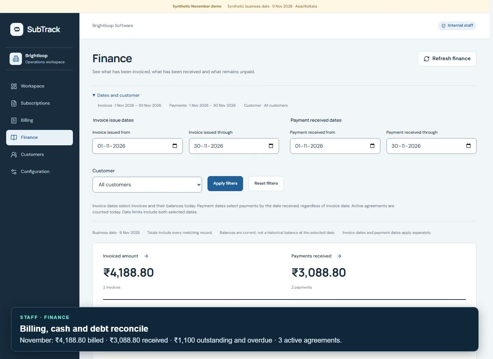

# SubTrack demo

[](subtrack-demo.mp4)

[Watch or download the MP4](subtrack-demo.mp4)

**1 minute 58 seconds · 1440 × 1050 · H.264 MP4 · 2.0 MB · no audio.** Captions are embedded in the video.

A silent walkthrough with on-screen captions, covering the administrator, staff and customer portals. It uses a fresh synthetic November fixture with Studio's first ₹1,000 payment already recorded.

## Walkthrough

- **Admin:** product and variant configuration, recurring plan rules and discount eligibility.
- **Staff:** quotation preparation and one new Draft, followed by Studio's invoice and its remaining ₹2,088.80 collection. November finance reconciles ₹4,188.80 invoiced, ₹3,088.80 received and ₹1,100 outstanding/overdue.
- **Customer:** own subscription, permitted service controls, Paid invoice and print view.

The extra quotation remains Draft, so it does not change the established invoice/payment totals.

The recorded UI journey completed successfully, including the reviewed payment and saved finance reconciliation. The recording used application revision `d6403f3`.

## Demo boundaries

The business date is fixed to **9 November 2026** and visibly labelled. All accounts, invoices and receipts are synthetic. Recording a receipt does not move money.

P9 quotation assistance is shown as disabled in this isolated offline fixture; the ordinary manual quotation form remains available. No live model request, SMTP delivery or real financial operation is part of this recording. A print view demonstrates the saved invoice, not an emailed PDF attachment.

To start a separate fresh fixture:

```powershell
npm run build
npm run demo -- --settlement=partial
```

See the [team guide](../working/README.md) for setup, credentials, business rules and verification evidence.
