# SubTrack: team guide

SubTrack connects Brightloop's subscription business from product setup and quotation to billing, collection and finance. This guide explains the system for Junaid and Lakshmi, with source links for deeper questions.

**Checked release:** `main` at `22e5efa`, 31 October 2026. Mandatory P0–P8 and optional P9 are implemented in their recorded scope. Performance evidence covers the documented local desktop environment; mobile large-data timing remains unmeasured.

## Contents

1. [What we built and why](#1-what-we-built-and-why)
2. [Stack, architecture and files](#2-stack-architecture-and-files)
3. [Run the application](#3-run-the-application)
4. [Database and security](#4-database-and-security)
5. [Catalog, quotations and subscriptions](#5-catalog-quotations-and-subscriptions)
6. [Exact money, taxes and discounts](#6-exact-money-taxes-and-discounts)
7. [Billing, retries and invoice actions](#7-billing-retries-and-invoice-actions)
8. [Payments and service changes](#8-payments-and-service-changes)
9. [Finance and the numerical demo](#9-finance-and-the-numerical-demo)
10. [P9: AI-assisted quotations](#10-p9-ai-assisted-quotations)
11. [Tests, performance and limits](#11-tests-performance-and-limits)
12. [Evaluator walkthrough and quick answers](#12-evaluator-walkthrough-and-quick-answers)

## 1. What we built and why

Brightloop sells recurring software, variants and optional add-ons. Spreadsheets make it easy to miss renewals, duplicate bills or lose track of partial payments. SubTrack keeps the agreement, its invoices, receipts and service history connected in one persisted system.

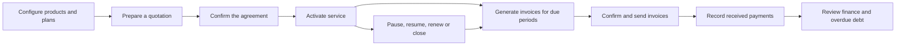

**Admin** configures the business and creates staff. **Staff** manage quotations, billing, collections and reporting. **Customers** see their own records and use service actions permitted by their accepted plan.

This is a standalone application for the Odoo event's Brightloop problem, not an Odoo Python module or a personal subscription-spending tracker.

## 2. Stack, architecture and files

| Part | Technology | Purpose |
|---|---|---|
| Browser | React 19, React Router 7, TypeScript | Screens, navigation and form state |
| Client tooling | Vite 8 | Development assets and production bundle |
| Server | Node.js 24+, Express 5, TypeScript | APIs, authorization and business rules |
| Database | Node built-in SQLite; direct parameterized SQL | Persistent relational records; no ORM |
| Validation | Shared Zod 4 schemas | Client feedback and independent server validation |
| Interface | Handwritten CSS, Lucide icons, locally shipped Fontsource fonts | Consistent responsive controls |
| Security/email | Helmet, Node crypto, Nodemailer | Headers, password/token handling and controlled SMTP |
| Optional AI | Server `fetch` to OpenAI Responses | Structured catalog suggestions; no agent framework |
| Verification | ESLint, TypeScript, Node tests, Supertest, Playwright | Code checks, real database/API tests and Chromium journeys |

Exact installed dependencies are in [package-lock.json](../../package-lock.json); available commands are in [package.json](../../package.json). React hooks/context manage state; normal HTTP and job polling handle updates. There is no required cloud database, Redux or WebSocket service.

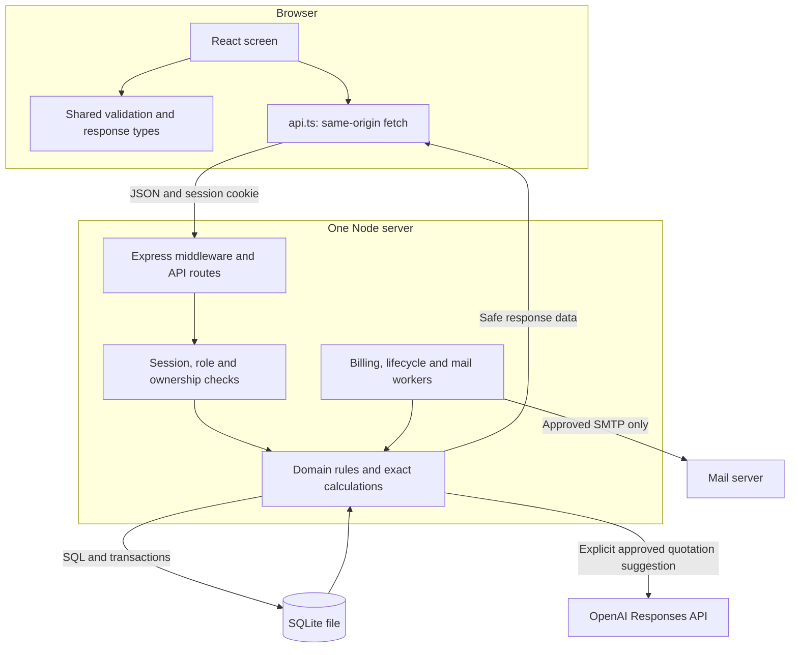

**One request:** screen → `src/api.ts` → Express security/route checks → shared validation → domain calculation → SQLite transaction → safe response → refreshed screen. The browser never opens SQLite or decides authoritative totals, roles or payment status.

| Location | Responsibility |
|---|---|
| [src/App.tsx](../../src/App.tsx), [src/Workspace.tsx](../../src/Workspace.tsx) | Routes, role-aware navigation, directories and resource/list hooks |
| [src/api.ts](../../src/api.ts), [src/session.tsx](../../src/session.tsx), [src/ui.tsx](../../src/ui.tsx) | Fetch/CSRF, session, feedback, dialogs and shared controls |
| `src/Catalog.tsx`, `Subscriptions.tsx`, `Billing.tsx`, `BillingWorkbench.tsx` | Configuration, agreements, invoices and saved billing runs |
| `src/Payments.tsx`, `Lifecycle.tsx`, `Finance.tsx`, `QuoteAssist.tsx` | Collection, service, reporting and P9 |
| [server/index.ts](../../server/index.ts), [server/app.ts](../../server/app.ts) | Startup, assets, middleware, routers and workers |
| [server/database.ts](../../server/database.ts), `server/*-schema.ts` | SQLite setup, forward migrations and transactions |
| [server/](../../server/) feature modules | Catalog/subscription/billing/payment/lifecycle/finance/output rules |
| [shared/](../../shared/) | Allowed inputs and safe response types for each feature |
| [tests/](../../tests/), [docs/](../) | Executable checks, requirements, decisions and evidence |

Related features usually have matching client, shared and server files. Start there when tracing an action.

### Development versus production

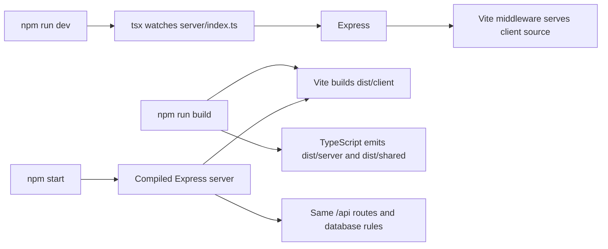

Development uses Express with Vite middleware at one origin. Production serves the built client and compiled server. Both use the same domain rules and database. Generated databases/builds/reports are excluded from development watching to avoid the observed Windows file-watch problems.

## 3. Run the application

Use Node.js **24+** and npm. From the repository root:

```powershell
npm ci
npm run db:seed
npm run dev
```

Open [localhost:3000](http://localhost:3000). After first setup, daily startup is just `npm run dev`; stop with Ctrl+C. Database creation/migrations happen automatically. `db:seed` is optional, additive and never automatic; it adds synthetic identities without resetting existing records. `npm run db:migrate` remains an explicit maintenance command.

Seed identities: `admin@brightloop.test`, `staff@brightloop.test`, `maya@brightloop.test`, `arun@brightloop.test`, all using the public fixture password **`Brightloop!2026`**. These are synthetic accounts, not real credentials.

For a compiled local run:

```powershell
npm run build
npm start
```

### Configuration

Default operation needs no `.env`. To customize, copy [.env.example](../../.env.example) only if `.env` does not already exist:

```powershell
if (-not (Test-Path -LiteralPath .env)) {
    Copy-Item -LiteralPath .env.example -Destination .env
}
```

| Settings | Meaning |
|---|---|
| `PORT`, `APP_ORIGIN` | Default 3000 / `http://localhost:3000`; open the configured origin |
| `DATABASE_PATH` | Default ignored `data/subtrack.sqlite`; keep on local disk |
| `MAIL_MODE` | Default `outbox`; `smtp` requires approved settings/recipients |
| `SMTP_*`, `MAIL_FROM`, `MAIL_ALLOWED_RECIPIENTS` | Private transport settings and exact approved test-recipient allowlist |
| `OPENAI_API_KEY`, `AI_QUOTE_ENABLED`, `AI_QUOTE_BUDGET_USD` | Optional server-only AI; disabled/zero by default |

Restart after changing settings. Never expose credentials through `VITE_` variables. Normal app data, temporary test databases, the November demo and the large benchmark fixture are separate. Test/demo launchers do not load the normal `.env` or send real SMTP.

## 4. Database and security

SQLite is a deliberate local fallback: no Docker or hosted account is required. It is a real database with constraints and durable records, but a single-machine deployment with serialized writers. Synchronous queries can block the Node event loop, so query cost still matters.

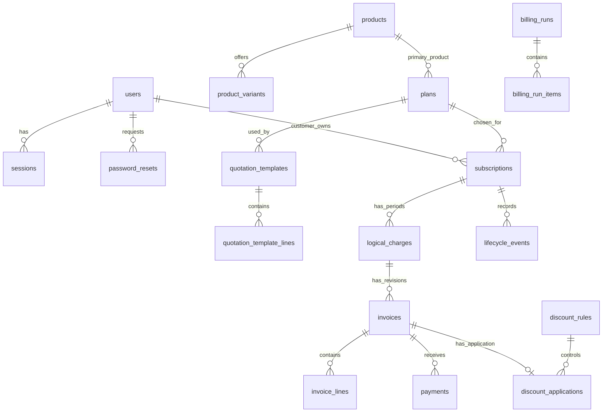

The current schema has **35 tables across migrations 1–12**. Customers are `users` rows with role `customer`.

| Group | Main stored facts |
|---|---|
| Identity | Users, hashed sessions/reset tokens, authentication limits |
| Configuration | Products/variants, plans, taxes, templates/lines, discount rules/targets |
| Agreements | Subscriptions, offered/accepted snapshots, request receipts and history |
| Billing | Logical period charges, invoice revisions/lines, discount applications, generation receipts/history |
| Operations | Billing runs/items, replacement/send receipts, outbox and audit events |
| Collection/service | Immutable payments, effective lifecycle events and request receipts |
| P9 | AI request allowance ledger, bound proposals and review receipts |

Configuration is relational; saved commercial snapshots preserve historical terms. Persisted JSON snapshots are database records, not static frontend fixtures. Migration 11 adds measured list-order indexes; migration 12 adds AI bookkeeping. See [schema code](../../server/database.ts) for the complete table/migration definitions.

### Transactions and locking

Writes use `BEGIN IMMEDIATE`: one writer makes the final decision at a time. Invoice, reservation, period outcome, receipt, history and cursor commit together or roll back together. Reads can use a consistent transaction. Foreign keys, STRICT/CHECK constraints, unique indexes and triggers protect the stored facts.

WAL allows better reader/writer coexistence; `synchronous=FULL` and a 1,000 ms busy timeout are configured. Contention returns a retryable `503 DATABASE_BUSY`. There is no JavaScript mutex library: SQLite write locks provide mutual exclusion, while persisted worker claims coordinate jobs.

### Login and permissions

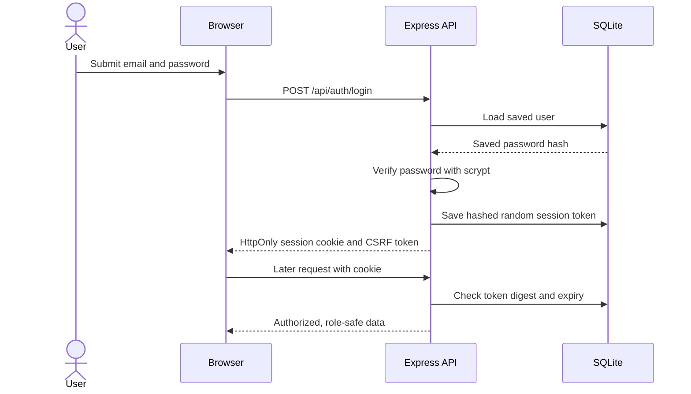

Emails are normalized and unique even under concurrent signup. Passwords require more than eight characters, uppercase, lowercase and a special character; a digit is not mandatory. Passwords use salted scrypt hashes. Random session/reset tokens are stored as digests.

Sessions last 12 hours, using HttpOnly/SameSite cookies and Secure cookies for HTTPS origins. Signed-in writes require CSRF tokens; API writes check Origin when supplied and require JSON. Reset links are newest-only, single-use and expire after 30 minutes; successful reset revokes sessions. Authentication throttles persist.

| Operation | Admin | Staff | Customer |
|---|---|---|---|
| Create staff; edit configuration/discounts | Yes | No | No |
| Quote, bill, record payment, view finance, use P9 | Yes | Yes | No |
| Read agreements/invoices and print | All | All | Own only |
| Allowed pause/resume/renew/early close/add-on actions | Yes | Yes | Own only |
| End-of-term Close / global email activity | Yes | Close only | No |
| Product cost | Yes | No | No |
| Internal payment notes | Yes | Authorized invoice workflow | No |

Server guards and serializers enforce this independently of navigation. Customer payloads omit costs/internal notes; staff cannot read cost prices. Public signup fixes role to customer; only admin creates staff. Hidden buttons are not the security boundary.

## 5. Catalog, quotations and subscriptions

**Product** means what is sold: name, type (`software`, `service`, `addon`), sales/cost prices and notes. A **variant** is a configured adjustment, such as Odoo +₹560. A **plan** supplies the primary product's replacement price, cadence, minimum quantity, availability and lifecycle rights. A **template** copies plan/line selections and validity into a new quotation.

```text
Primary unit = plan replacement price + selected variant adjustment
Add-on unit  = product sales price + selected variant adjustment
```

Never add both the primary catalog base and the plan base. Exactly one primary-product line is required, and its quantity must meet the plan minimum.

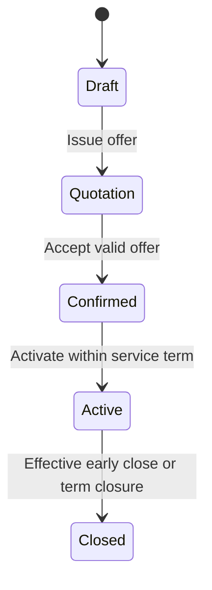

- **Draft:** server prices current selections; explicit edits reprice.
- **Quotation:** issuing freezes the offered terms for its inclusive validity window.
- **Confirmed:** acceptance preserves the offer; current availability/publication/eligibility is rechecked without silently repricing it.
- **Active:** service is within its term; activation does not require payment.
- **Closed:** future service stops; history and earlier debt remain.

Later catalog/template edits cannot rewrite an issued/accepted snapshot. Configuration updates use a version to detect stale edits. Archives retain identity; there is no general delete endpoint.

A future-start agreement stays Confirmed until activation. **Explicit** `/api/subscriptions/process-due` handles due activation; the normal lifecycle timer handles service changes/expiry, not activation. Commercial stage and service state differ: an Active agreement can be Paused or TermEnded.

### Calendar rules

Business dates use **Asia/Kolkata**; event timestamps use UTC. Service periods are **[start, end)** and billed in advance. Daily/weekly use calendar days; monthly/yearly use the original anchor and period index. January 31 → February 28 → March 31 avoids drift; leap-day anchors recover in leap years.

Expiry must align with a whole period; no partial-period proration. Quote validity and plan availability have inclusive last dates. Invoice due date is generation issue date + payment-term days; due today is not overdue. The browser cannot override the business clock.

## 6. Exact money, taxes and discounts

Amounts use integer paise, with bounded BigInt intermediate calculations. Rates use basis points: 1,000 = 10%. Decimal input allows at most two places; large finance aggregates travel as strings to preserve exactness.

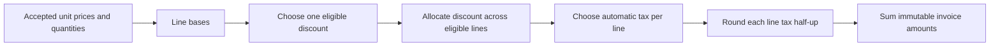

The server chooses one automatic tax per line by priority, product scope at a tie, then stable ID. Tax is exclusive, after discount, rounded half-up per line. The fictional demo rules do not imply statutory tax compliance.

Discounts support fixed/percentage amounts, product/subscription scope, amount/quantity thresholds, inclusive dates and maximum uses. Both thresholds must pass when configured. One eligible rule wins by priority then stable ID; no stacking. Eligibility uses **generation date**, including backlog invoices.

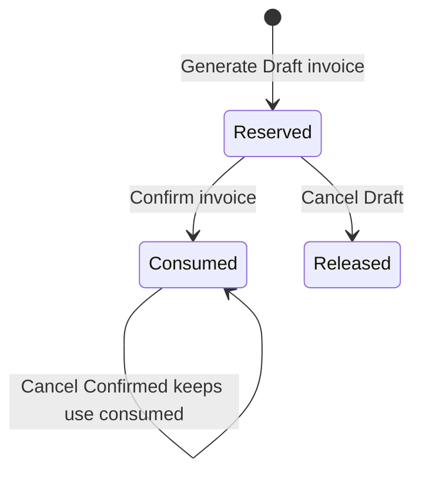

Preview reserves nothing. Draft generation atomically reserves a use; confirmation consumes that same use even after rule expiry. Draft cancellation releases it; Confirmed cancellation retains it. Replay cannot consume twice, and reservations do not silently expire.

Fixed discounts are capped at eligible base. Percentage discounts round once across eligible scope; both kinds allocate proportionally using largest fractional remainders and stable line IDs. This keeps the sum exact, including one-paisa edge cases.

## 7. Billing, retries and invoice actions

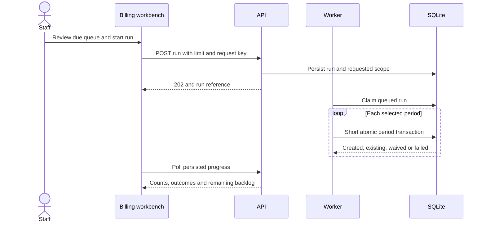

Runs are persisted, default to 250 items and allow limits 1–500. The worker uses short per-item transactions and yields between items; closing the tab does not delete work. The UI polls while queued/running. Worker tokens and a 60-second lease support recovery of stale work.

```text
Logical charge identity = subscription + period start + period end + kind
Invoice revision        = logical charge + revision number
```

Database uniqueness prevents duplicate period charges. Outcomes distinguish created, already-existing, explicitly non-billable and failed/retryable periods. Selected future records may be not due; this is not a permanent waiver. The cursor cannot advance on failed writes. Retry targets the original failed periods; backlog counts due subscriptions, not all owed periods.

Billing evaluates effective history: a current Paused/Closed badge cannot hide an older owed period.

### Three different safeguards

| Safeguard | Question it answers |
|---|---|
| Idempotency key, bound to actor/payload | Did this exact intended submission already succeed? |
| Record version / reviewed preview | Has the record or calculation changed since review? |
| Transaction + database constraints | Can concurrent operations commit conflicting facts? |

Exact retries return saved results; conflicting key reuse returns 409. Some stage/confirm/cancel actions use version/history receipts rather than UUID keys. A timeout does not prove failure: inspect saved results before starting a new intended submission.

### Invoice lifecycle and output

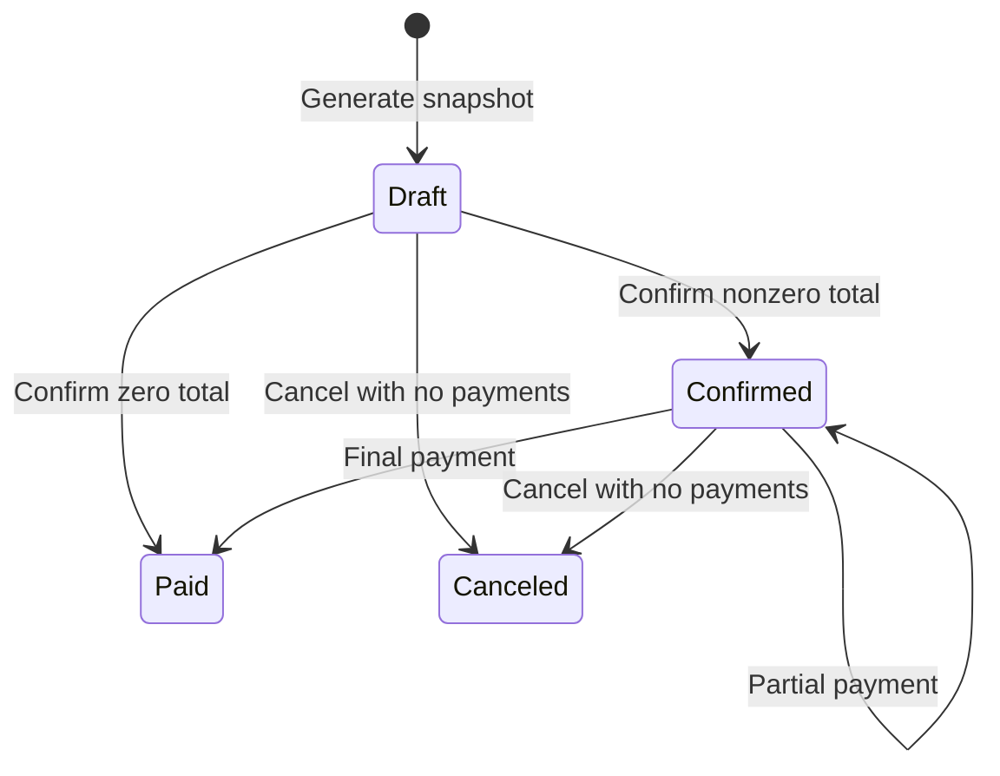

Generated Draft amounts are immutable. Confirm makes a nonzero invoice collectible. Partial payment stays Confirmed; zero balance becomes Paid. Zero-total confirmation records settlement without a fake payment.

Cancel only Draft/Confirmed invoices with no payment ever recorded; Paid cannot cancel. Correct an eligible canceled current invoice through explicit linked replacement, with version, reviewed preview hash and request key. Replacement rechecks current tax/discount eligibility, may change the total, retains old history and does not advance the period cursor again.

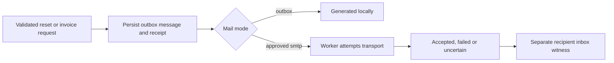

Send queues a notice to the saved customer address. Outbox generation, Sending, SMTP Accepted, Failed and Unknown are distinct; acceptance alone is not inbox proof. Uncertain interrupted messages are not blindly resent. New sends reject canceled/superseded revisions.

Print returns escaped, ownership-checked saved HTML with truthful status. Browser **Print / Save as PDF** is the download path; emailed PDF attachments are not claimed. Send/print do not confirm or settle invoices. Existing controlled inbox and rendered PDF witnesses are in [P5 evidence](../evidence/P5_DELIVERY_AND_PRINT.md).

## 8. Payments and service changes

Staff record received money against a specific Confirmed invoice: positive amount, method, payment date and internal note. This does not charge a card or move money. The server rejects overpayment, future dates and wrong currency.

Inside the write transaction, matching replay is resolved first; a new request then checks the latest outstanding. Payment insertion and balance/status updates commit together. Concurrent receipts cannot jointly overpay. Equal real receipts can have different keys; an exact retry returns its original allocation even after Paid. Payments are immutable; reversal/refund UI is outside this baseline.

| Service action | Effective behavior |
|---|---|
| Pause / resume | Original period boundaries; full paused periods get explicit waivers |
| Early close | Stops future service at permitted boundary; old debt remains |
| Expiry | Auto-close gives Closed; otherwise TermEnded awaits internal Close |
| Renew | Extend by whole periods at accepted terms; preserve anchor/cursor |
| Add-on toggle | Change optional accepted line at future eligible boundary; primary cannot disable |

Plan rights come from accepted policy. Pause/close/add-on requests skip periods already decided by invoice, failure or waiver; UI shows requested/effective dates. Pause does not extend expiry or erase bills. Resume cannot rewrite old waivers.

Renew before or exactly at expiry if permitted; late gaps and early-closed terms require a fresh quote. Renewal and expiry serialize. The normal server applies due lifecycle work at startup/every ten seconds; staff also have explicit processing controls.

## 9. Finance and the numerical demo

| Metric | Definition |
|---|---|
| Active agreements | Current Active-stage terms before expiry/effective closure; includes paused subset |
| Invoiced amount | Confirmed/Paid totals after discount and including tax; excludes Draft/Canceled |
| Payments received | Actual positive allocations by payment-event date |
| Outstanding | Current unpaid balance of selected invoices |
| Overdue | Positive outstanding with due date before today |

Invoice issue-date and payment-event ranges are separate. Customer filtering scopes all axes; date ranges do not turn the active count into a historical count. Outstanding is current debt for the selected invoice cohort, not an old “as of” reconstruction.

Summaries cover all filtered rows, not the visible page. Invoice/payment facts aggregate separately to avoid line × payment join multiplication. Finance endpoints are internal-only.

### Explain these numbers

| Example | Calculation/result |
|---|---|
| A: two Odoo-variant units | (₹1,000 plan + ₹560 variant) × 2 = ₹3,120 |
| Discount/tax | ₹3,120 − 10% = ₹2,808; + fictional 10% tax = **₹3,088.80** |
| A's payments | ₹1,000 leaves ₹2,088.80, still Confirmed; final ₹2,088.80 gives Paid |
| B | ₹1,000 + ₹100 fictional tax = **₹1,100**, unpaid |
| C | October 15 period genuinely billed/paid; next due November 15 |
| November finance | **3 active; ₹4,188.80 billed; ₹3,088.80 collected; ₹1,100 outstanding/overdue** |

Use explicit November invoice/payment ranges. On the demo date, November 9, B is overdue after November 8; C is not due. C's October history stays outside the selected month. These are demo totals, not lifetime benchmark totals.

## 10. P9: AI-assisted quotations

Admin/staff can describe synthetic needs in **New quotation**. AI proposes existing catalog choices; normal server calculation and explicit human save remain authoritative.

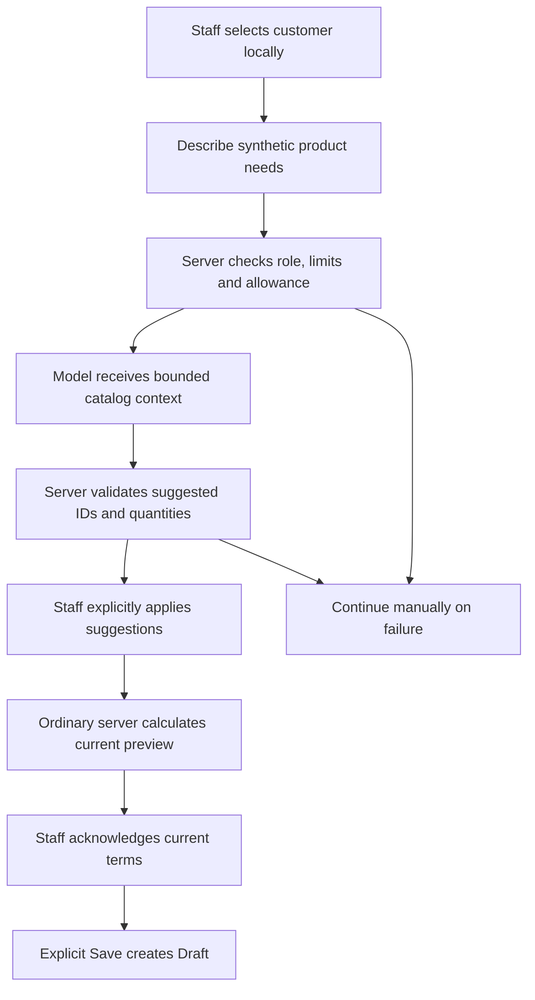

| Stage | What happens |
|---|---|
| Request | Staff selects customer locally; server checks role, limits and allowance before dispatch |
| Suggest | Fixed release model `gpt-4.1-mini`, Responses Structured Outputs, no tools, `store:false` |
| Validate | Strict schema, allowed IDs, variant ownership, quantities, dates and duplicate-product checks |
| Apply | Staff explicitly copies selections into the ordinary form; templates load real stored lines |
| Review/save | Server calculates preview; staff acknowledges and explicitly saves Draft |
| Failure | Preserve entries and Continue manually; no automatic retry/model substitution |

AI cannot choose customer identity, authoritative prices, taxes, discounts, status or financial actions. Proposal requests persist AI bookkeeping, not subscriptions/invoices/payments.

### Binding, privacy and spending

- Proposals belong to one actor/customer and expire after 15 minutes. Server-stored `reviewHash` binds the current calculation; changed terms require re-preview/review. Successful ordinary create replay is checked first, so a lost response still returns the original Draft.
- Provider context excludes server-supplied customer identity/email, money, cost, notes and payment history. Only synthetic free text is authorized; name/email checks are not a general personal-data detector. `store:false` does not mean zero retention.
- Context is capped at 20 active plans, 30 products, 100 variants and 20 templates; valid choices can be omitted. Text ≤1,000 characters, context/instructions ≤20 KiB, full JSON ≤24 KiB, output ≤800 tokens, provider deadline eight seconds.
- Each user gets one in-flight request and five requests per 15 minutes; no separate global rate cap. Allowed proposals contain at most ten lines and five clarifications.
- Each call atomically reserves **$0.02** in one database's persisted ledger. Known usage reconciles; unknown/timeout outcomes retain the reserve. This is not a provider-project/cross-database cap.
- The approved $5 release allowance included $0.001075 application-accounted evaluation; the recorded remaining cap is $4.998925. Preserve existing approval/settings; this guide authorizes no new key or spend.

**Source:** [QuoteAssist UI](../../src/QuoteAssist.tsx), [proposal routes](../../server/ai-quote.ts), [review guard](../../server/ai-quote-review.ts), [migration 12](../../server/ai-quote-schema.ts), [shared contract](../../shared/ai-quote.ts). APIs are internal `GET /api/ai/quote-assist`, `POST /api/ai/quote-proposals`, followed by ordinary subscription preview/create with optional AI review fields.

Three real synthetic release calls passed: known request → server-calculated **₹3,120 subtotal** → one explicit Draft/save replay; unsupported/ambiguous requests → clarification. Generation took 3,735/3,942/999 ms; optional generation is separate from page readiness. The fixed model's future availability is not guaranteed; failures leave manual entry available. See [P9 verification](../evidence/P9_VERIFICATION.md) and [implemented policy](../OPTIONAL_AI.md).

## 11. Tests, performance and limits

```powershell
npm run check
npx playwright install chromium
npm run test:e2e
```

`check` runs lint → client/server typechecks → domain/integration tests → production build. Browser tests are separate. They use production assets, Chromium, isolated SQLite and injected AI providers; they do not load real SMTP/API credentials. Domain fixtures and independent-process races check persisted rules, rollback, replay and concurrency.

**Recorded P9 release:** 181 tests, 30 browser journeys (including four P9 journeys), plus separate live synthetic AI, inbox and print witnesses. This edit's fresh `npm run check` passed lint, both typechecks, 181 tests and build; `npm run test:e2e` passed 30/30 in 52.3 seconds. All 12 original diagrams are unchanged; links, anchors and Markdown passed validation. Build warning remains **633.24 kB minified / 179.40 kB gzip**. No new live AI, SMTP, PDF or benchmark run was performed; test-suite duration is not page latency.

### What the large-data evidence actually says

The fixture contains **10,000 subscriptions** across four cadences, **30,000 invoices**, **60,000 lines**, **27,400 positive payments**, **31,056 logical charges** and **2,600 lifecycle events**. An independent audit checks underlying financial/calendar facts.

Full desktop coverage included **93 destination/role/state variants**, **115 role/API paths** and **14 interactions**, with 50 warm samples and separate cold probes. The run retained a **2,647.127 ms** cold billing-queue breach. List-sort indexes and corrected queue selection addressed measured bottlenecks; three affected queue variants then repeated without errors/breaches, maximum cold page **515.857 ms**.

This combines complete inventory coverage with affected-path repeats, not a completed full post-fix rerun. The redundant repeat was interrupted; large-data mobile benchmarking was canceled. OS caches were not flushed. Five-context measurements included customer denial pages, not five finance users. A 250-item batch completed in **48.4 seconds**; that measures throughput, not page response.

P9's changed forms were separately repeated on the large fixture: 150 warm/three cold navigations, zero breaches, **289.1794 ms maximum**. This does not create a new full-inventory/mobile claim. Seven archived P8 runs preserve 20,922 observations and failures.

See [P8 dataset](../evidence/P8_DATASET.md), [performance scope/results](../evidence/P8_PERFORMANCE.md) and [P9 form evidence](../evidence/P9_FORM_PERFORMANCE.json). Hardware, cold/warm boundaries and every retained breach belong to those records; timings do not guarantee WAN or production capacity.

To reproduce with a new output path and at least 1.5 GB free disk:

```powershell
npm run benchmark:seed -- --output=data/p8-example.sqlite
python scripts/verify-benchmark.py data/p8-example.sqlite
npm run build
npm run benchmark -- --manifest=data/p8-example.sqlite.manifest.json --samples=50 --label=release
```

The runner copies isolated databases and normally uses port 3004. [Benchmark inventory](../../server/benchmark-pages.ts) defines real data/control readiness; [runner](../../server/benchmark.ts) records API, browser, action, concurrency and batch timings. Python scripts audit raw facts/results and package sanitized evidence without remeasurement. Smoke/subset runs are not full coverage.

### Honest scope

All 28 mandatory IDs are mapped in [the implementation ledger](../IMPLEMENTATION_STATUS.md); FIN-02 is qualified to the documented local desktop scope. The product is one company, INR and local SQLite. No live gateway/bank feed, multi-tenancy, multi-currency, general proration/repricing, refunds/payment reversal, full accounting ledger or historical as-of finance is claimed. No external deployment or contest entry is claimed. Optional P9 is implemented; it is not autonomous financial management.

## 12. Evaluator walkthrough and quick answers

```powershell
npm run build
npm run demo -- --settlement=partial
```

Open [localhost:3003](http://localhost:3003). This fresh, labelled November 9 synthetic database never loads `.env` or sends SMTP. Admin/staff logins use the ordinary fixture identities/password. Customers are `studio@brightloop.test`, `shop@brightloop.test`, `services@brightloop.test`, also using `Brightloop!2026`. Default `npm run demo` settles A already; `unpaid`/`partial` modes let you record remaining synthetic receipts live.

**Show in order:** configuration → A's agreement/price history → invoice calculation → saved batch outcomes → partial/final collection → November finance → B's overdue/C's not-due history → customer ownership/print → P9 Apply/review/manual fallback → evidence and limits. Demonstrate new records after the fixed totals, or use a fresh demo: extra records change the witness numbers. Do not depend on a new paid AI call during evaluation.

| Evaluator asks | Clear answer |
|---|---|
| Is the dashboard hardcoded? | No; server queries persisted SQLite facts. Seeds are labelled starting data. |
| Why SQLite? | Local simplicity and real transactional constraints; single-machine scaling limits are explicit. |
| Where is security enforced? | Server role/ownership checks and safe serializers, not menu visibility. |
| What prevents duplicate money/bills? | Bound submission receipts, logical-period uniqueness and atomic writes. |
| Do you use mutexes? | SQLite write locks and persisted worker claims; no application mutex library. |
| What if the catalog changes? | Offered/accepted/invoiced snapshots preserve history; new drafts use current settings. |
| Can AI decide prices or save automatically? | No; ordinary server calculation, human review and explicit Draft save remain required. |
| What makes it impressive? | One connected workflow, correct money/history, tested failure/concurrency handling, useful AI and measured scale evidence. |

### Finding a screen or API

Main screens: `/workspace`, `/subscriptions`, `/subscriptions/new`, `/subscriptions/:id/service`, `/billing/invoices`, `/billing/workbench`, `/billing/runs`, `/finance`, `/customers`, `/configuration/*`; admin adds `/staff` and `/deliveries`. Customer lists/detail/print are own-record only.

APIs use `/api`, same-origin cookies and CSRF on signed-in writes. Lists normally use `{items,total,page,pageSize}` with default 20/max 100. Errors carry a code, useful message, optional field errors and request ID. Mutation schemas reject unexpected fields; JSON body limit is 16 KB. Read [API_CONTRACT.md](../API_CONTRACT.md) for endpoint/payload details rather than memorizing every path.

Forms preserve entries after errors where mounted; URL filters retain scope; stale writes require review. The fetch timeout is 15 seconds, not a performance target. Unsaved forms are in memory, not a browser recovery database. Shared labels, keyboard focus, dialogs, status text and responsive layouts support usable desktop/narrow-screen flows.

### If something fails

Check Node version, intended origin/port and database first. Install dependencies with `npm ci`; build before production/demo/browser runs. Retry database contention after the other write finishes. For stale payment amounts, inspect latest receipts before correcting. Outbox Generated does not mean inbox delivery; Unknown needs review before another send. Never delete an unexplained database or reset a spend ledger to make the demo work.

For deeper questions, use [requirements](../REQUIREMENTS.md), [decisions](../DECISIONS.md), [domain edge cases](../DOMAIN_AND_EDGE_CASES.md), [judge walkthrough](../JUDGE_WALKTHROUGH.md), [root setup guide](../../README.md) and [design context](../../DESIGN.md). Newest explicit clarification and the actual brief outrank historical planning; the latest executed evidence determines what can be claimed.
