# SubTrack: understand the whole project

SubTrack is a complete subscription management system for Brightloop that connects product setup, quotations, recurring subscriptions, billing, payments, and financial reporting in one database-backed application. It includes secure admin, staff, and customer access; configurable plans, variants, taxes, and discounts; batch invoicing, partial payments, lifecycle controls, email and print workflows, and AI-assisted quotation preparation. Its strength is the care behind those features: exact money calculations, protected financial history, safe retries and concurrent operations, plus documented desktop performance testing with 10,000 subscriptions.

> **For Junaid and Lakshmi:** this is a study guide for understanding, demonstrating and explaining the project. Read it with the application open. Follow the source links when you want to see the actual implementation.
>
> **Scope checked on 31 October 2026:** the application on `main` at `c5c3759`, before this documentation update. Mandatory P0–P8 and optional P9 quotation assistance are complete in the recorded scope. The ledger records all 28 requirements as Verified. FIN-02 has a **local desktop** evidence scope: the complete inventory had one real queue breach, the affected workload was corrected and repeated successfully, and the later full repeat was interrupted. Large-data mobile performance was canceled and is unmeasured. Sections 23 and 29 explain the results and limits.

## How to use this guide

You do not need to memorize every function. Both teammates should understand the journey, where the data lives, who can change it, and why the safety rules exist.

| Time available | Read first | What you should be able to explain |
|---|---|---|
| 10 minutes | Sections 1–4, 13 and 24 | The problem, stack, connected workflow and numerical demo |
| 30 minutes | Add sections 5–12 and 15–18 | Files, data, permissions, pricing, billing, payments and finance |
| Full preparation | Read everything; rehearse sections 24–25 together | Technical choices, failure cases, proof and remaining work |

### Contents

1. [What we built and why](#1-what-we-built-and-why)
2. [What is implemented and what is still pending](#2-what-is-implemented-and-what-is-still-pending)
3. [The technology stack](#3-the-technology-stack)
4. [How all the parts connect](#4-how-all-the-parts-connect)
5. [Repository map](#5-repository-map)
6. [How to install, run and build it](#6-how-to-install-run-and-build-it)
7. [Configuration and environments](#7-configuration-and-environments)
8. [Database design and relationships](#8-database-design-and-relationships)
9. [Login, password reset and access control](#9-login-password-reset-and-access-control)
10. [Products, variants, plans, taxes and templates](#10-products-variants-plans-taxes-and-templates)
11. [How quotations become subscriptions](#11-how-quotations-become-subscriptions)
12. [Money, rounding and automatic discounts](#12-money-rounding-and-automatic-discounts)
13. [A complete billing and payment example](#13-a-complete-billing-and-payment-example)
14. [Dates and recurring schedules](#14-dates-and-recurring-schedules)
15. [Billing runs, failures and duplicate protection](#15-billing-runs-failures-and-duplicate-protection)
16. [Invoice actions, cancellation and replacement](#16-invoice-actions-cancellation-and-replacement)
17. [Recording partial and full payments](#17-recording-partial-and-full-payments)
18. [Pause, resume, renewal, expiry and add-ons](#18-pause-resume-renewal-expiry-and-add-ons)
19. [Finance: what each number means](#19-finance-what-each-number-means)
20. [Screens, navigation and frontend behavior](#20-screens-navigation-and-frontend-behavior)
21. [API map and request rules](#21-api-map-and-request-rules)
22. [Email, print and background workers](#22-email-print-and-background-workers)
23. [Tests, evidence and performance](#23-tests-evidence-and-performance)
24. [An evaluator walkthrough you can rehearse](#24-an-evaluator-walkthrough-you-can-rehearse)
25. [Evaluator questions and clear answers](#25-evaluator-questions-and-clear-answers)
26. [Requirement-by-requirement map](#26-requirement-by-requirement-map)
27. [Troubleshooting and making changes safely](#27-troubleshooting-and-making-changes-safely)
28. [Glossary and further reading](#28-glossary-and-further-reading)
29. [P9: AI-assisted quotation preparation](#29-p9-ai-assisted-quotation-preparation)

## 1. What we built and why

**SubTrack is a subscription operations system for Brightloop Software.** Brightloop sells recurring software, products with variants, and optional add-ons. Its staff need to manage the whole business journey in one place.

Without a connected system, a team might keep subscriptions in spreadsheets, remember renewals manually, type invoices again, record bank receipts elsewhere, and then rebuild totals for reports. That creates missing bills, duplicate bills and unclear balances.

SubTrack connects these steps:

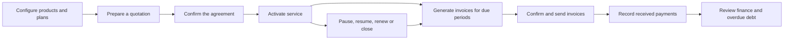

An important difference: this is a business tool for the company selling subscriptions. It is not a personal app for tracking Netflix or Spotify spending.

### Is this an Odoo application?

The repository is named `odoo` because of the event context. The implemented product is a standalone application called **SubTrack**, built for the supplied Brightloop problem statement. It does not use the Odoo Python framework, Odoo modules, or an Odoo database.

### The three kinds of users

| User | Their main job |
|---|---|
| Administrator | Configure the business, create staff accounts, and perform operations |
| Internal staff | Prepare agreements, run billing, record collections and follow up on debt |
| Customer | Read their own agreements/invoices, print their own invoices and use permitted service actions |

The product is for one company. Staff operate across its customers. There is no separate tenant, branch, or staff-assignment system.

## 2. What is implemented and what is still pending

The code and the latest implementation ledger describe the current product. Some older planning documents still say “documentation only” or describe a future stack. Those sentences describe the original handoff. They do not mean the present application is a mockup.

| Area on the checked `main` | Recorded position | Where to check |
|---|---|---|
| Setup, persistence and shared contracts | P0 Verified | [Implementation ledger](../IMPLEMENTATION_STATUS.md) |
| Signup, sessions, roles and password reset | P1 Verified | Ledger and [delivery evidence](../evidence/P1_DELIVERY.md) |
| Products, variants, plans, taxes and templates | P2 Verified | Ledger and catalog tests |
| Quotations and subscription stages | P3 Verified | Ledger and subscription tests |
| Invoices, automatic taxes and discounts | P4 Verified | Ledger and billing tests |
| Batch workbench, replacement, send and print | P5 Verified | Ledger and [output evidence](../evidence/P5_DELIVERY_AND_PRINT.md) |
| Payments and service lifecycle | P6 Verified | Ledger and [integrity evidence](../evidence/P6_INTEGRITY.md) |
| Finance and connected customer portal | P7 Verified | Ledger and finance/browser tests |
| Page response with thousands of subscriptions | P8 / FIN-02 Verified for the documented local desktop scope | [Performance evidence](../evidence/P8_PERFORMANCE.md); retained failures, corrected-path repeats and unmeasured mobile scope |
| AI-assisted quotation preparation | Optional P9 implemented and verified | [P9 verification](../evidence/P9_VERIFICATION.md); three live synthetic requests, eleven focused tests and four new browser journeys |

“Verified” above reports the evidence recorded for that feature. It does not mean security certification, production readiness, or unlimited scale.

### Features deliberately outside this implementation

There is no live payment gateway, automatic card charge, bank feed, multi-currency support, tenant isolation, full accounting ledger, refund/payment reversal UI, partial-period proration, general mid-term repricing or historical “as of” balance reconstruction. AI quotation suggestions are implemented; autonomous financial actions are outside their authority.

### What remains beyond the verified scope?

The checked main includes P8 fixture, measurement, audit and query work and the completed Optional P9 quotation assistant. The organizer/checklist handoff is separate; no contest entry or external deployment is claimed. Later uncommitted or feature-branch changes are not described as released features here. This guide changes documentation only; each measurement still belongs to its recorded code/build and environment.

## 3. The technology stack

A **frontend** is the part running in the browser. A **backend** receives requests and enforces rules. A **database** stores records after the browser or server closes.

The following are package families from [package.json](../../package.json), not a promise that every installed patch version equals the range shown there. [package-lock.json](../../package-lock.json) records the exact dependency resolution.

| Technology | What it does here | Why it is useful |
|---|---|---|
| Node.js 24+ | Runs the server and command-line tools; provides SQLite and test primitives | One local runtime for the TypeScript application |
| TypeScript 5.9 | Adds checked types to client, server and shared contracts | Helps catch incompatible inputs and responses before running |
| React 19 and React DOM | Render browser screens from components and state | Reusable forms, lists, records and feedback |
| React Router 7 | Maps browser URLs to screens | Direct links, nested layouts and back/forward navigation |
| Vite 8 and its React plugin | Serve development assets and build the production client | Fast development and a distributable browser bundle |
| Express 5 | Handles HTTP/API routes and serves the application | Connects browser requests to the business modules |
| Node built-in SQLite | Stores relational data in a local file | No separate database installation or hosted account |
| Zod 4 | Validates actual values at runtime | Rejects invalid and unexpected fields on client and server |
| Helmet | Applies HTTP security headers | A shared place for response header protection |
| Nodemailer | Talks to an approved SMTP server | Optional controlled delivery of reset and invoice notices |
| Lucide React | Supplies interface icons | Consistent icons throughout the screens |
| Fontsource DM Sans and Manrope | Ship fonts with the app | Fonts do not need an external Google Fonts request |
| Handwritten CSS | Controls colors, spacing and responsive layouts | One consistent interface without a separate CSS framework |
| tsx | Runs TypeScript scripts and watch mode | Development, database commands and tests |
| ESLint and typescript-eslint | Check code quality rules | Catch mistakes and enforce the configured conventions |
| Node test runner | Executes domain/integration tests through `tsx` | Tests actual application functions and HTTP behavior |
| Supertest | Calls Express in automated tests and fixture setup | Exercises routes with persisted SQLite records |
| Playwright | Operates a real Chromium browser | Checks the rendered application and full user journeys |
| npm | Installs dependencies and runs scripts | A shared command interface for the team |

There is no ORM: server modules use SQL directly. There is also no Redux, GraphQL, WebSocket server, or required model API. React hooks/context and normal HTTP requests cover this product's current needs.

Optional P9 calls the OpenAI Responses API from the server using native `fetch`, Structured Outputs and the fixed release model `gpt-4.1-mini`. It adds no agent framework or provider SDK dependency. The manual product still works without model access.

The manifest includes type-definition packages, ESLint support packages and a `minimatch` override. These support development/dependency resolution; they are not separate product features.

### Why SQLite?

The adopted fallback keeps the application runnable on one local machine when the Docker daemon is unavailable. SQLite is a real persisted relational database. Foreign keys, transactions, uniqueness and triggers still matter.

The tradeoff is that SQLite serializes writers, and the synchronous Node database calls can block the event loop while a query runs. WAL and short transactions help, but they do not make this a distributed or infinitely scalable deployment. Performance must be measured.

## 4. How all the parts connect

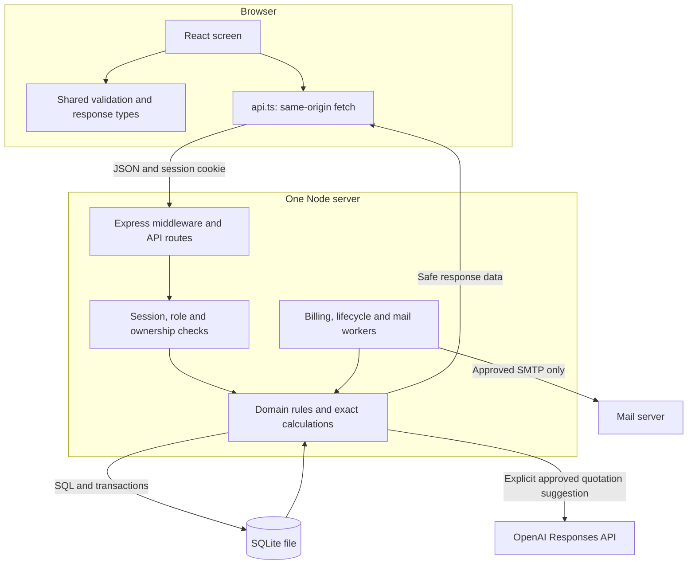

### Follow one payment from the screen to finance

1. A staff member opens an invoice. React fetches its saved total and outstanding balance.
2. They enter an amount, method, date and note. Shared validation catches ordinary input mistakes.
3. They review the payment and submit. `src/api.ts` sends JSON, the session cookie and CSRF token.
4. Express checks the session and staff permission. The payment route validates the fields again.
5. The server opens a write transaction and checks whether the submission key already exists. An exact retry returns the original result, including after the invoice became Paid.
6. For a new payment, it checks the latest invoice state and balance. It cannot trust an older screen.
7. A new valid payment is stored. Database triggers update payment totals and invoice status in the same transaction.
8. The server returns the saved payment and updated invoice. The screen shows the new balance.
9. Finance requests read the committed facts and calculate the new collections/outstanding amounts.

React never opens the SQLite file. The browser does not decide an invoice's authoritative amount, owner, or Paid status.

### Development versus production

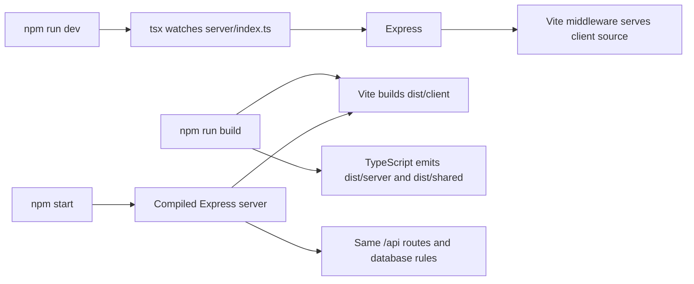

Both modes use the backend. Development is not a different static-data application.

## 5. Repository map

Paths below are relative to the repository root. The links work from this guide on GitHub.

```text
odoo/
|-- src/                  Browser interface
|-- server/               API, domain rules, SQL, workers and local tools
|-- shared/               Request schemas and response contracts
|-- tests/                Database/domain/API tests and browser journeys
|-- docs/                 Brief mapping, policies, roadmap and evidence
|   `-- working/README.md This guide
|-- public/               Static favicon
|-- index.html            Browser entry document
|-- package.json          Dependencies and executable scripts
|-- package-lock.json     Locked dependency graph
|-- .env.example          Safe configuration template
|-- vite.config.ts        Client build configuration
|-- tsconfig*.json        Browser/server TypeScript settings
|-- eslint.config.js      Lint rules
|-- playwright.config.ts  Browser test setup
|-- DESIGN.md             Interface design decisions
|-- UX-CONTRACT.md        Shared interaction expectations
|-- PRODUCT.md            Product context
`-- AGENTS.md             Repository contribution instructions

Generated/ignored: node_modules/, dist/, data/, .env,
                  test-results/, playwright-report/, output/pdf/
```

### The most useful implementation files

| File or group | Responsibility |
|---|---|
| [src/main.tsx](../../src/main.tsx), [src/App.tsx](../../src/App.tsx) | Start React and declare all browser routes |
| [src/api.ts](../../src/api.ts), [src/session.tsx](../../src/session.tsx) | HTTP requests, current user, CSRF and session expiry |
| [src/ui.tsx](../../src/ui.tsx), [src/styles.css](../../src/styles.css) | Shared controls, feedback, dialogs and styling |
| [src/Workspace.tsx](../../src/Workspace.tsx) | Navigation shell, workspace, people lists and resource/list hooks |
| [src/Auth.tsx](../../src/Auth.tsx) | Login, signup and reset screens |
| [src/Catalog.tsx](../../src/Catalog.tsx) | Product/plan/tax/template configuration and price preview |
| [src/Subscriptions.tsx](../../src/Subscriptions.tsx) | Draft editor, subscription list/detail and stage actions |
| [src/Billing.tsx](../../src/Billing.tsx) | Discount configuration, invoice records and single-period generation |
| [src/BillingWorkbench.tsx](../../src/BillingWorkbench.tsx) | Due queue, saved batch runs, outcomes and retry |
| [src/Payments.tsx](../../src/Payments.tsx), [src/Lifecycle.tsx](../../src/Lifecycle.tsx) | Payment review and effective service actions |
| [src/QuoteAssist.tsx](../../src/QuoteAssist.tsx), [shared/ai-quote.ts](../../shared/ai-quote.ts) | Optional suggestion UI, allowed proposal fields and status/review contracts |
| [server/ai-quote.ts](../../server/ai-quote.ts), [server/ai-quote-review.ts](../../server/ai-quote-review.ts), [server/ai-quote-schema.ts](../../server/ai-quote-schema.ts) | Provider requests, bounded budget/context, human-review guards and persisted AI tables |
| [src/Finance.tsx](../../src/Finance.tsx), [src/InvoiceOutput.tsx](../../src/InvoiceOutput.tsx) | Financial summaries/drilldowns and email/print controls |
| [server/index.ts](../../server/index.ts) | Start HTTP server, assets and scheduled jobs; graceful shutdown |
| [server/app.ts](../../server/app.ts) | Assemble middleware, database and all API routers |
| [server/config.ts](../../server/config.ts) | Read server environment settings |
| [server/database.ts](../../server/database.ts), `server/*-schema.ts` | Open SQLite, migrate schema and wrap transactions |
| [server/identity.ts](../../server/identity.ts), [server/security.ts](../../server/security.ts), [server/password.ts](../../server/password.ts) | Identity, permission checks, sessions and password hashing |
| [server/catalog.ts](../../server/catalog.ts), [server/subscriptions.ts](../../server/subscriptions.ts) | Sellable configuration and commercial agreement rules |
| [server/billing.ts](../../server/billing.ts), [server/billing-workbench.ts](../../server/billing-workbench.ts) | Financial snapshots and durable batch execution |
| [server/payments.ts](../../server/payments.ts), [server/lifecycle.ts](../../server/lifecycle.ts) | Allocation and effective service rules |
| [server/finance.ts](../../server/finance.ts) | Reporting SQL and exact aggregates |
| [server/mail.ts](../../server/mail.ts), [server/invoice-output.ts](../../server/invoice-output.ts) | Email transport/outbox and safe print output |
| [server/calendar.ts](../../server/calendar.ts), [server/money.ts](../../server/money.ts) | Calendar boundaries and authoritative money calculations |
| [server/errors.ts](../../server/errors.ts) | Consistent safe errors and request IDs |
| [server/demo.ts](../../server/demo.ts), [server/demo-fixture.ts](../../server/demo-fixture.ts) | Isolated November demonstration |
| [server/benchmark-fixture.ts](../../server/benchmark-fixture.ts), [server/benchmark-validation.ts](../../server/benchmark-validation.ts) | Large synthetic dataset and its domain-fact validation |
| [server/benchmark.ts](../../server/benchmark.ts), [server/benchmark-pages.ts](../../server/benchmark-pages.ts) | Production timing runner and page/action readiness inventory |
| [server/performance-schema.ts](../../server/performance-schema.ts) | Measured list-order index migration |
| [scripts/](../../scripts/) | Independent Python database/timing audits and sanitized evidence packaging |
| [shared/](../../shared/) | Feature-specific Zod inputs, DTOs and shared money helpers |

The feature names line up intentionally: payment screens live in `src/Payments.tsx`, their API/domain logic in `server/payments.ts`, and their contract in `shared/payments.ts`.

## 6. How to install, run and build it

### First local setup

Use Node.js **24 or newer** and npm. The documented development machine uses Windows; the following commands are PowerShell. Keep SQLite on local disk.

After installing dependencies once, daily startup is just `npm run dev`: one terminal serves Express and the React client together. Database creation/migration is automatic, and `.env` is optional for default local operation. The expanded sequence below explicitly migrates and adds synthetic identities for a first rehearsal; startup itself never seeds users.

Run these from your actual repository directory:

```powershell
npm ci
if (-not (Test-Path -LiteralPath .env)) {
    Copy-Item -LiteralPath .env.example -Destination .env
}
npm run db:migrate
npm run db:seed
npm run dev
```

Open [the local application](http://localhost:3000). The server binds to `127.0.0.1`; the normal database defaults to `data/subtrack.sqlite`.

`npm ci` uses the lockfile. `db:migrate` creates/applies the database schema. `db:seed` adds synthetic users. Startup does not seed automatically. These commands are additive; there is no supported destructive reset command.

### Synthetic local identities

| Role | Ordinary local seed email | Public fixture password |
|---|---|---|
| Admin | `admin@brightloop.test` | `Brightloop!2026` |
| Staff | `staff@brightloop.test` | `Brightloop!2026` |
| Customer | `maya@brightloop.test` | `Brightloop!2026` |
| Customer | `arun@brightloop.test` | `Brightloop!2026` |

These are intentionally documented synthetic credentials. They are not credentials for real customer accounts. The seed preserves existing accounts and rejects conflicting reserved-role identities rather than silently promoting someone.

### Production assets locally

```powershell
npm run build
npm start
```

The build checks types, writes browser assets into `dist/client`, and compiles server/shared TypeScript into `dist/`. `npm start` uses the compiled server and production assets. It fails with a useful message if the client build is missing.

### Available scripts on the checked main

| Command | Purpose | Important detail |
|---|---|---|
| `npm run dev` | Watch server TypeScript; serve browser development assets | Normal configured database and clock |
| `npm run db:migrate` | Apply forward database migrations | No database reset |
| `npm run db:seed` | Add ordinary synthetic identities | Explicit opt-in |
| `npm run build` | Typecheck, build client, compile server | May report a bundle-size warning |
| `npm start` | Serve compiled application | Build first |
| `npm run lint` | Run ESLint | Zero warnings allowed |
| `npm run typecheck` | Check client/shared and server configurations | No application execution |
| `npm test` | Run domain/database/API tests | Test files run with concurrency one |
| `npm run check` | Lint → typecheck → tests → build | Browser tests are separate |
| `npm run test:e2e` | Run real browser journeys | Requires build and Chromium |
| `npm run demo` | Launch isolated November fixture | Production build first; port 3003 by default |
| `npm run mail:check` | Report mail readiness/missing names | Does not prove delivery |
| `npm run verify:email` | Send a controlled real reset check | Explicit external side effect; approved configuration/recipient required |
| `npm run verify:invoice` | Send a controlled real invoice notice | Explicit external side effect; approved recipient required |
| `npm run verify:print` | Generate three local proof PDFs | Isolated fixture; no real email |
| `npm run benchmark:seed` | Create fresh large synthetic SQLite fixture and manifest | Refuses an existing output file; does not read `.env` |
| `npm run benchmark -- --manifest=...` | Measure APIs, pages, actions, concurrency and batch work | Production build first; isolated database copies |

Benchmark auditing/packaging scripts additionally use Python's standard library. Python is not needed for ordinary application startup. Section 23 gives the benchmark commands and exact scope.

## 7. Configuration and environments

The normal server reads `.env` through `server/config.ts`. The tracked [.env.example](../../.env.example) contains names and safe defaults. `.env` itself is ignored by Git.

| Setting | Meaning |
|---|---|
| `PORT` | Local listening port; default 3000 |
| `APP_ORIGIN` | Browser origin used for links and request-origin checks; default `http://localhost:3000` |
| `DATABASE_PATH` | SQLite file; default `./data/subtrack.sqlite` |
| `MAIL_MODE` | `outbox` for local generation; `smtp` for configured transport |
| `SMTP_HOST`, `SMTP_PORT`, `SMTP_SECURE` | SMTP connection settings |
| `SMTP_USER`, `SMTP_PASSWORD` | Server-only SMTP credentials |
| `MAIL_FROM` | Configured sender address |
| `MAIL_ALLOWED_RECIPIENTS` | Exact comma-separated approved test-recipient allowlist |
| `OPENAI_API_KEY` | Server-only credential for optional quotation suggestions; manual workflows need no key |
| `AI_QUOTE_ENABLED` | Explicit optional-assistant enablement; default false |
| `AI_QUOTE_BUDGET_USD` | Approved per-database USD allowance; default zero disables AI; positive and at most $5 required |

Set `APP_ORIGIN` to the same origin you open in the browser, including the correct port. Origin checks distinguish `localhost` from `127.0.0.1`. Restart the normal server after configuration changes.

Never put a credential in a `VITE_` variable: Vite-prefixed variables can be exposed to browser code. The application needs no model key to function.

The recorded P9 approval reused an existing server key and a $5 total allowance. Controlled evaluation accounted for $0.001075, leaving the configured normal-app cap at $4.998925. Preserve the authorized remaining allowance and private key; this guide does not authorize new calls, credentials or spending. See section 29 for persisted reservations and manual fallback.

### Separate data environments

| Environment | Database and date | Why separate it? |
|---|---|---|
| Ordinary app | Configured local database; real server business clock | Normal use and persistent development |
| Domain/API tests | Fresh temporary databases; injected test clock | Repeatable cases without modifying local records |
| Browser tests | Unique temporary SQLite database; dedicated port 3100 | Real interface testing against production assets |
| November demo | Fresh retained `data/november-demo-*.sqlite`; fixed November 9 date | Rehearsable business story with visible synthetic label |
| Large-data benchmark | Separate seed plus runtime/batch copies; fixed synthetic November 9 clock | Thousands-row measurement without changing the November walkthrough or local database |

Test/demo launchers do not load the normal `.env` or send real SMTP. A fixed test clock is injected by the trusted server setup, not chosen by an ordinary customer request.

## 8. Database design and relationships

SQLite stores the real business records. A customer is a row in `users` with role `customer`; there is no separate customer table.

The following is a **simplified relationship diagram**, not a complete SQL schema. Some historical relationships are saved inside snapshots rather than separate join tables.

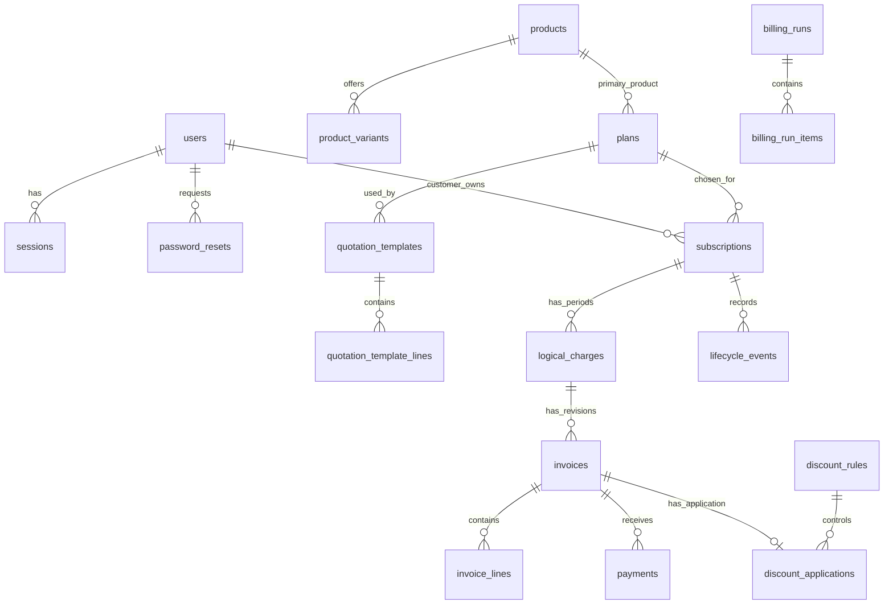

### The final 35 tables on the checked main

| Area | Tables | Plain-language role |
|---|---|---|
| Schema and numbering | `schema_migrations`, `reference_counters` | Remember applied migrations and issue unique readable references |
| Identity | `users`, `sessions`, `password_resets`, `auth_limits` | People, login sessions, reset tokens and throttling |
| Communication/history | `outbox`, `audit_events` | Saved email and audit facts |
| Catalog | `products`, `product_variants`, `plans` | What is sold, its variants and recurring rules |
| Tax/templates | `tax_rules`, `quotation_templates`, `quotation_template_lines` | Automatic tax configuration and reusable quotation selections |
| Agreements | `subscriptions`, `subscription_requests`, `subscription_history` | Contract state/snapshots, replay receipts and stage history |
| Discounts | `discount_rules`, `discount_targets`, `discount_applications` | Rules, targeted products and per-invoice usage |
| Financial billing | `logical_charges`, `invoices`, `invoice_lines`, `invoice_generation_requests`, `invoice_history` | One period identity, invoice revisions/amounts, generation receipts and history |
| Batch processing | `billing_runs`, `billing_run_items` | Durable batch headers and individual period results |
| Output/replacement receipts | `invoice_replacement_requests`, `invoice_send_requests` | Prevent duplicate successor invoices and duplicate queued notices |
| Collections | `payments` | Immutable invoice-linked payment facts and submission keys |
| Service | `lifecycle_events`, `lifecycle_requests` | Requested/effective actions and replay receipts |
| Optional AI | `ai_quote_requests`, `ai_quote_proposals`, `ai_quote_reviews` | Persisted spend reservations/outcomes, actor/customer-bound suggestions and reviewed-preview receipts |

### Why keep snapshots as well as catalog records?

Configuration changes over time. A product's selling price next month must not rewrite a quotation already offered this month.

The catalog is relational configuration. A subscription stores offered/accepted commercial snapshots, including selected lines and plan policies. An invoice stores its own immutable header/line amounts, tax/discount decisions and versions. Some snapshots are JSON in database columns; they are persisted historical data, not static frontend JSON fixtures.

### Migrations

Migrations are versioned changes to the database shape. They run when the database opens; `db:migrate` is the explicit setup command. The checked `main` has versions 1–12:

| Version | Added or protected |
|---|---|
| 1 | Users |
| 2 | Sessions, resets, outbox, throttling and audit |
| 3 | Uncertain email outcome support |
| 4 | Catalog, plans, taxes and quotation templates |
| 5 | Subscriptions, snapshots and stage/request history |
| 6 | Discounts, logical charges and invoices |
| 7 | Durable billing workbench, cursors and replacement/send receipts |
| 8 | Payment allocations |
| 9 | Effective service lifecycle/history |
| 10 | Stronger protection connecting cached payment balances to immutable facts |
| 11 | Created-date/ID order indexes for measured subscription and invoice list bottlenecks; no new tables |
| 12 | Optional AI request allowance ledger, bound proposals and human-review receipts |

### What protects the data?

| Mechanism | What it prevents or provides |
|---|---|
| Foreign keys | References to records that do not exist |
| `STRICT` tables and checks | Wrong stored types and invalid values/states |
| Unique keys/indexes | Duplicate emails, logical periods, revisions and submission keys |
| Database triggers | Forbidden financial edits and inconsistent payment/discount transitions |
| Parameterized SQL | User input becoming executable SQL text |
| Write transaction: `BEGIN IMMEDIATE` | Two writers making conflicting decisions at the same time |
| Read transaction: `BEGIN` | Different parts of one report seeing inconsistent snapshots |
| WAL journaling | Better coexistence of readers and a writer |
| `synchronous=FULL` | Configured durable synchronization behavior |
| One-second busy timeout | Bounded contention wait, followed by a useful retryable error |

**Atomic** means all related changes succeed together, or none do. If invoice generation fails after reserving a discount, the transaction rolls back the invoice, reservation, receipt and cursor changes together.

## 9. Login, password reset and access control

### Signup and login

Email is trimmed and lowercased. The database also enforces unique case-insensitive email. Two simultaneous signups cannot create two users for the same normalized address.

Public signup always creates a customer. It does not accept a user-selected role. Only an admin can create staff through the staff endpoint.

Passwords must be more than eight characters and contain uppercase, lowercase and a special character. A digit is not required by the brief. The shared validation also bounds input length and handles the tested Unicode cases.

Passwords are not stored as plaintext. `server/password.ts` creates a random salt and uses **scrypt**, a deliberately expensive password-hashing function. Verification uses a timing-safe comparison.

### How the session works

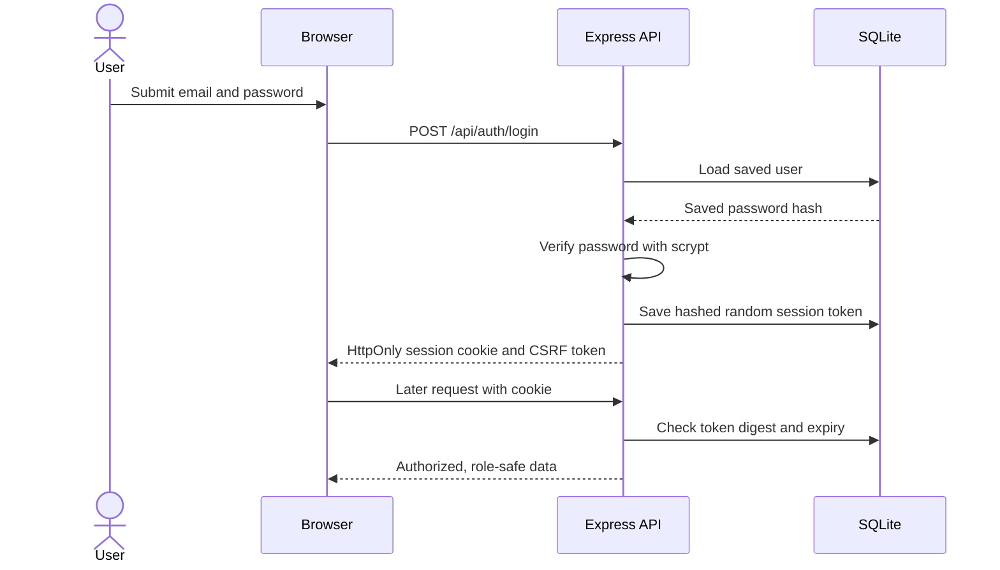

The cookie holds a random token. The database stores its SHA-256 digest, not the raw session token. Sessions last 12 hours. The cookie uses `HttpOnly` and `SameSite=Lax`; it uses `Secure` when the configured origin is HTTPS. Login rotates the session, logout revokes it, and password reset revokes the user's sessions.

An authenticated write also needs an `X-CSRF-Token` header. The browser receives that token from the session response and holds it in memory. The server checks request origin when supplied and requires JSON for non-read API operations. Authentication attempt limits are persisted.

### Password reset

1. The user submits an email address.
2. The public response is generic whether or not that address exists.
3. For a registered user, the server generates a random reset token and queues a message.
4. The token expires after 30 minutes; only the newest reset link works.
5. The link carries the token in a URL fragment. The reset UI removes the fragment after reading it.
6. Successful reset changes the password and invalidates reset tokens and sessions.

Outbox mode proves message generation. Actual inbox delivery is separate evidence; the repository records a controlled reset inbox witness.

### Permission matrix

| Operation | Admin | Staff | Customer |
|---|---|---|---|
| Create staff | Yes | No | No |
| Write product/plan/tax/template/discount configuration | Yes | No | No |
| Read operational configuration | Yes | Yes, without costs | Published safe catalog through authorized API views; no internal configuration screen |
| Create/edit Draft and issue/confirm/activate agreement | Yes | Yes | No |
| Request/apply quotation suggestions | Yes | Yes | No |
| Read subscriptions and invoices | All | All | Own only |
| Plan-permitted pause/resume/renew/early close/add-on requests | Yes | Yes | Own only |
| Explicit end-of-term Close | Yes | Yes | No |
| Generate/confirm/cancel/replace invoice | Yes | Yes | No |
| Record received payment | Yes | Yes | No |
| Send invoice notice | Yes | Yes | No |
| Print invoice | All authorized records | All authorized records | Own only |
| Finance-wide views | Yes | Yes, reporting access | No |
| View product cost | Yes | No | No |
| View internal payment notes | Yes | Yes, authorized invoice workflow | No |
| Global email activity | Yes | No | No |

Browser route guards make navigation understandable. **The server is the access-control boundary.** Changing a URL or calling an API directly cannot grant access. Customer queries/serializers enforce ownership and omit private fields, rather than sending private values and hiding them with CSS.

## 10. Products, variants, plans, taxes and templates

These are separate concepts because they answer different questions.

| Record | Question it answers | Main fields/rules |
|---|---|---|
| Product | What are we selling? | Name, type, selling price, internal cost, notes, active flag |
| Variant | Which version/brand is selected? | Belongs to product; named price adjustment; active flag |
| Plan | On what recurring commercial terms? | Primary product, replacement unit price, cadence, minimum quantity, availability, lifecycle permissions |
| Tax rule | Which automatic tax calculation applies? | Rate, global/product scope, priority, active flag |
| Quotation template | Which selections should staff reuse? | Plan, product/variant quantities, validity days, active flag |
| Subscription instance | What did this customer agree to? | Customer, reference, dates, terms, stage and saved commercial snapshot |

Products/variants support configuration rather than hardcoded brand branches. The Odoo +₹560 example is a configured variant adjustment.

Product types are `software`, `service` and `addon`. Internal staff can read operational product notes but not cost price; customer catalog responses omit both cost and internal notes.

### The key price decision

The plan's price **replaces the primary product's catalog base price**. It is not an extra hidden fee.

```text
Primary unit price = accepted plan price + selected variant adjustment
Add-on unit price  = accepted product sales price + selected variant adjustment
Line base          = unit price × whole quantity
```

Example: catalog base ₹1,200, plan price ₹1,000, Odoo adjustment ₹560. The primary unit is ₹1,560. Charging ₹1,200 + ₹1,000 + ₹560 would charge the base twice and is rejected as the product interpretation.

There must be exactly one primary-product line. The plan minimum quantity applies to that line, not unrelated add-ons. Staff use the server preview to see the breakdown before creating a contract.

### Updates and archives

Configuration updates include the version last read. If another admin edited the record first, the server returns a conflict rather than overwriting newer data. Archived/inactive configuration retains its identity for history; there is no general delete endpoint.

Template lines are copied into an instance. Editing that instance does not edit the reusable template, and editing a template does not rewrite an issued offer.

## 11. How quotations become subscriptions

An agreement has a unique readable subscription number, customer, selected plan, start date, exclusive expiry date, payment terms, validity and saved lines.

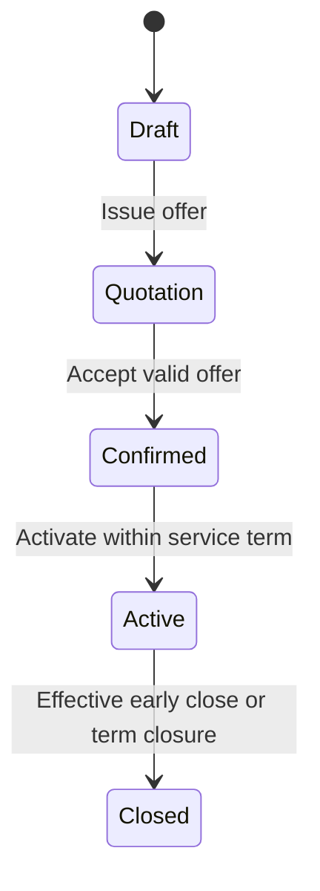

| Stage | What it means | Can commercial selections change? |
|---|---|---|
| Draft | Staff are preparing the offer | Yes, through explicit server repricing/edit |
| Quotation | The offer has been issued | Frozen for its validity window |
| Confirmed | Customer terms have been accepted | Accepted snapshot is frozen |
| Active | Service has started | Service actions follow accepted policy; no general commercial rewrite |
| Closed | Service term has been closed | History and prior debt remain |

### The freeze happens in steps

- Creating or explicitly editing a Draft uses current server configuration.
- Issuing the Quotation freezes the offered prices and plan capabilities.
- Confirming preserves that exact offer. It rechecks current publication, availability and product/variant eligibility, but does not quietly recalculate the issued price.
- Invoice generation uses accepted prices, then chooses tax/discount eligibility for the invoice-generation date.

This is why a later catalog change cannot silently alter an existing customer agreement.

P9 can help fill the New quotation form. Staff explicitly apply a suggested selection, obtain an ordinary server preview, acknowledge its current terms and save Draft. The AI suggestion does not itself create an agreement. [Section 29](#29-p9-ai-assisted-quotation-preparation) explains proposal binding, changed-price review and safe replay.

### Dates, validity and activation

A quotation valid for seven days includes its issue day and ends on issue day + six days. The start/expiry of service, quote validity and plan availability are different date concepts.

A future-start agreement stays Confirmed. It can activate only when the server business date is inside its term. Payment is not a condition for activation in our adopted policy.

There is an explicit internal `POST /api/subscriptions/process-due` action for due Confirmed agreements. The normal ten-second lifecycle timer handles service changes/expiry; **it does not activate future Confirmed agreements**. Do not describe that timer as automatic activation.

### Stage and service state are different

An Active-stage agreement can be Running or Paused. If its term ends with auto-close disabled, it can show **Term ended — close or renew** while awaiting an internal Close action. The service state explains operation; it does not replace the required commercial stage progression.

## 12. Money, rounding and automatic discounts

### Why amounts are stored in paise

Ordinary decimal floating-point calculations can introduce small errors. Instead, ₹1,560.00 is represented as **156000 paise**. The server uses bounded `BigInt` intermediate arithmetic and explicit rounding.

| Concept | Example |
|---|---|
| Minor units | ₹1.25 = 125 paise |
| Basis points | 10% = 1000 basis points; 18% = 1800 |
| Decimal input | Text is parsed exactly; at most two decimal places |
| Individual amount ceiling | `1_000_000_000_000` paise = ₹10,000,000,000 |
| Large finance totals | Returned as decimal strings to preserve exactness beyond safe JavaScript integers |

The frontend displays INR with `en-IN` formatting. Display formatting does not perform authoritative business calculations.

### Calculation order

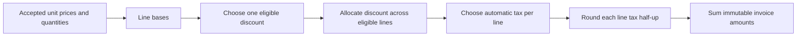

Taxes are exclusive, applied after discount. One active matching tax rule is selected per line: ascending admin priority, product-specific before global at a tie, then stable ID. The demo rules are fictional; this is not a claim of statutory tax compliance.

### What makes a discount eligible?

| Check | Rule |
|---|---|
| Administrator configuration | Only admin creates/edits the rule |
| Kind | Fixed amount or percentage |
| Scope | Eligible products or whole subscription; optional specific subscription target |
| Minimum amount/quantity | Both must pass when both are configured |
| Dates | Start/end inclusive, evaluated on generation business date |
| Usage cap | Reserved + consumed applications cannot exceed maximum uses |
| Rule choice | One rule per invoice, priority then stable ID; no stacking |
| Amount bound | Fixed discount cannot exceed eligible base; percentage is 0–100% |

An old backlog period generated today uses today's tax/discount eligibility. It does not pretend to have been generated on the old period's start date.

### How a limited use is protected

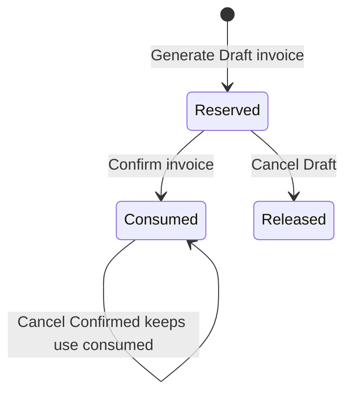

Preview does not reserve anything. Draft generation reserves atomically, so two workers cannot both take the last use. Confirming consumes that saved reservation even if the rule has since expired. Canceling a Draft releases it. Canceling an unpaid Confirmed invoice retains the consumed use. Reservations do not silently expire.

### What is largest-remainder allocation?

Suppose an eligible discount has to be split across lines and proportional division leaves fractions of a paisa. The server assigns whole paise first, then gives the remaining paise to the largest fractional remainders, breaking ties by stable line ID. The sum stays exactly equal to the discount.

A percentage first produces one rounded discount over the eligible scope. For two one-paisa lines at 50%, that is one paisa total discount. Rounding each line's discount independently could incorrectly discount both full paise. The implementation avoids that error.

## 13. A complete billing and payment example

The November fixture is the easiest shared story to learn. It uses real persisted records and the normal domain routes, with a visibly fixed synthetic clock.

### Customer A: Sample Studio

| Step | Calculation | Amount |
|---|---|---:|
| Primary plan unit | Monthly plan | ₹1,000.00 |
| Variant | Odoo adjustment per unit | +₹560.00 |
| Unit selling price | 1,000 + 560 | ₹1,560.00 |
| Quantity | 2 × 1,560 | ₹3,120.00 |
| LAUNCH10 | 10% eligible discount | −₹312.00 |
| Taxable base | 3,120 − 312 | ₹2,808.00 |
| Fictional demo tax | 10% × 2,808 | +₹280.80 |
| Invoice total | 2,808 + 280.80 | **₹3,088.80** |

The discount has one allowed use and minimum quantity two. Its reservation/consumption can be inspected.

### Customer B: Sample Shop

One unit without the variant: ₹1,000 + ₹100 fictional tax = **₹1,100**. It has no eligible A-specific discount.

### Customer C: Sample Services

C starts on October 15. Its October period has a real invoice and recorded payment. Its next monthly period starts November 15, so it is not due on the demo date, November 9. We do not fake a cursor jump to hide its October period.

### Collection changes the balance, not the invoice total

| Event | A's status | A's outstanding | A+B outstanding |
|---|---|---:|---:|
| Both November invoices confirmed | Confirmed | ₹3,088.80 | ₹4,188.80 |
| A pays ₹1,000 | Confirmed | ₹2,088.80 | ₹3,188.80 |
| A pays another ₹2,088.80 | Paid | ₹0.00 | ₹1,100.00 |

The invoice issue date is November 1 and payment terms are seven days, so due date is November 8. On November 9, B's remaining ₹1,100 is overdue.

### Expected finance with November ranges

| Metric | Value | Why |
|---|---:|---|
| Current active agreements | 3 | A, B and C have active current terms |
| November invoiced amount | ₹4,188.80 | A + B; C's invoice was issued in October |
| November payments received | ₹3,088.80 | A's two November allocations |
| Current outstanding in selected invoice cohort | ₹1,100.00 | B has not paid |
| Current overdue in selected invoice cohort | ₹1,100.00 | B's due date is before November 9 |

Use explicit November **invoice issue-date** and **payment event-date** filters. These are not lifetime totals. C's October history remains stored outside those ranges.

## 14. Dates and recurring schedules

Business dates use **Asia/Kolkata**. Recorded event timestamps use UTC. A plain business date such as `2026-11-01` is different from an instant such as `2026-11-01T04:00:00.000Z`.

Service periods use **[start, end)**: start included, end excluded. A November 1–December 1 period includes November 1 and ends just before the December 1 period begins. Billing is in advance at period start.

| Cadence | How the boundary moves |
|---|---|
| Daily | Calendar days from original anchor |
| Weekly | Seven calendar days per period |
| Monthly | Calendar months from original anchor, clamp target month's day |
| Yearly | Calendar years from original anchor, clamp if needed |

### Why monthly is not 30 days

For a January 31 anchor, the schedule is January 31 → February 28 → March 31. Every boundary is calculated from January 31 and the period index. Calculating from the previously clamped February 28 would drift to March 28.

A leap-day annual anchor similarly recovers February 29 when a leap year returns. Pause and renewal keep the original anchor.

Expiry must be a whole-period boundary. The baseline rejects a partial last period rather than inventing proration.

### Date rules to remember

| Date concept | Meaning |
|---|---|
| Plan availability | Inclusive dates for new confirmations; does not terminate accepted running terms |
| Quote validity | Issue date through issue date + valid days − 1 |
| Subscription expiry | Exclusive service boundary |
| Invoice issue date | Actual generation business date |
| Invoice due date | Issue date + nonnegative payment-term days |
| Overdue | Positive balance and business date later than due date |
| Payment date | Day receipt happened; cannot be in future |
| Recorded-at timestamp | When the system stored the payment/event |

An invoice due today is outstanding but not yet overdue. These calculations belong to the server; changing the browser clock does not change them.

## 15. Billing runs, failures and duplicate protection

Generating hundreds of invoices should be a durable job, not a browser loop that disappears when a tab closes.

### The batch flow

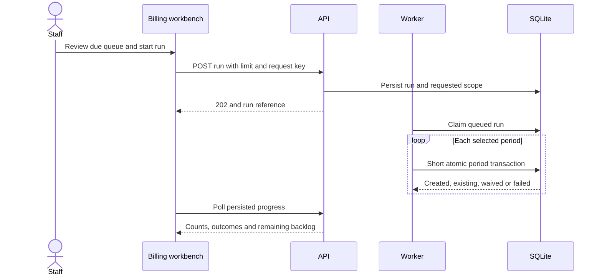

A run defaults to 250 items and accepts a bounded limit from 1 to 500. The worker yields between items. The screen polls queued/running progress every second. Closing the tab does not delete the persisted run.

### The period is the financial identity

```text
One logical charge = subscription + period start + period end + charge kind
One invoice revision = logical charge + revision number
```

The database enforces uniqueness. A current pointer identifies the invoice revision for that period. A canceled revision remains history; ordinary generation replay cannot silently recreate it.

| Outcome | Meaning | What the operator can do |
|---|---|---|
| Created | A new Draft invoice was saved | Review and confirm |
| Already exists | The period already has its logical result/current invoice | Open the saved record |
| Non-billable | Effective history explicitly waives that complete period, with reason | Inspect the reason/history |
| Failed | Processing could not complete; the period remains retryable | Correct cause and retry failed work |
| Not due | A selected record has no due period yet | Wait; this is not a permanent waiver |

The remaining backlog is a count of due subscriptions observed at the run's end, not a count of every historical period still owed.

### Why we examine history instead of today's badge

A subscription closed today may still owe a bill for a period before closure. A paused contract may still owe a period before its effective pause. Filtering only today's Active/Running records would hide debt. Billing evaluates accepted dates and effective historical events.

The cursor tracks the next unprocessed original period. A failed write cannot advance it. Failure, invoice and waiver outcomes remain explainable.

### Retry safety has several layers

| Layer | Job |
|---|---|
| Disabled/busy UI control | Reduces accidental repeated clicks |
| UUID idempotency key | Identifies one intended submission across lost-response retries |
| Actor and normalized payload binding | Rejects reuse of that key for a different action/actor |
| Record version | Rejects an edit/action based on stale state |
| Database uniqueness | Final protection against duplicate logical period/revision |
| Immediate write transaction | Serializes the final eligibility, reservation and write decision |

Idempotency and version checks solve different problems. Idempotency asks “did this exact submission already happen?” A version asks “has this record changed since I read it?”

Exact UUID-key replay returns the persisted result. Conflicting reuse returns 409. Some stage/confirm/cancel actions use version/history transition receipts rather than a UUID field; do not claim every endpoint takes the same key shape.

### Crash and worker recovery

Runs have worker ownership and a lease. Recovery checks queued/stale work at startup and periodically. Main uses a 60-second lease and a ten-second recovery interval. Each successful period result/counter update commits with its financial changes; an interruption cannot report a committed invoice without its corresponding successful outcome. A failed run item remains visible and explicit retry targets its failed period.

## 16. Invoice actions, cancellation and replacement

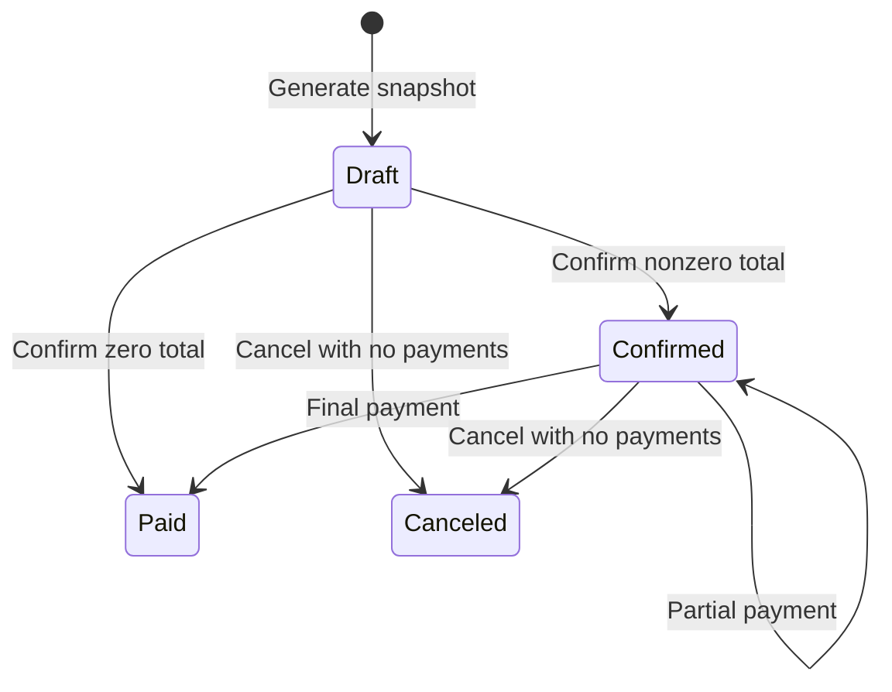

### What each action does

| Action | Effect | What it does not imply |
|---|---|---|
| Generate | Store a read-only Draft financial snapshot | Money is not yet collectible |
| Confirm | Make a nonzero invoice collectible; consume reserved discount | Does not record money received |
| Record payment | Add a positive receipt allocation | Partial receipt does not settle the rest |
| Cancel | Retain history and remove eligible unpaid invoice from collection | Does not delete it or erase a consumed discount |
| Replace | Create an explicit linked successor of eligible canceled current revision | Not ordinary period regeneration |
| Send | Queue a notice to saved customer address | Does not confirm or settle |
| Print | Render saved amounts/status for browser Print/PDF | Does not confirm or settle |

Even Draft amounts are immutable once generated. Correct mistakes with allowed cancellation and explicit replacement, rather than changing a financial snapshot invisibly.

Cancel is allowed only for Draft/Confirmed invoices with **no payment ever recorded**. Paid invoices cannot be canceled, including a zero-total Paid invoice. A zero invoice settles with reason “zero amount due”; it creates no invented zero payment.

### Why replacement needs a preview

Replacement requires the current canceled revision, no payments, its version, a fresh request key and a hash of the reviewed preview. Under the write lock, the server recomputes current tax/discount eligibility and compares the preview. A changed result conflicts before reserving usage or changing the current pointer.

The successor can have a different total. A consumed discount on a canceled Confirmed revision is not restored automatically. Both revisions remain linked; at most one current collectible revision exists. Replacement does not advance the billing cursor again.

## 17. Recording partial and full payments

The application records payments that have arrived. It does not charge a card or move money.

| Field | Meaning |
|---|---|
| Invoice ID | Exact debt receiving this allocation |
| Amount | Positive exact INR amount |
| Method | Bank transfer, cash, card, cheque or other |
| Payment date | Day the receipt happened |
| Internal note | Operational context; omitted from customer responses/output |
| Recorded by/at | Actor and actual recording timestamp |
| Submission key | Stable identity for this intended recording |

The UI provides a review step. The server rejects zero/negative values, overpayment, future dates, wrong currency, unauthorized actors and invoices that are not the current Confirmed revision.

```text
Outstanding = saved invoice total − committed payment allocations
Partial receipt: status remains Confirmed
Outstanding reaches zero: status becomes Paid
```

The transaction rechecks outstanding after obtaining the write lock. Two staff cannot jointly overpay just because both screens showed the same old balance.

Two identical amounts on the same day can be real separate receipts, so amount/date are not the duplicate key. Different valid submission keys can record equal legitimate payments. An exact retry of the same key returns the saved result even after settlement; changing the payload under that key is a conflict.

Payments are immutable. There is no baseline correction, reversal or refund interface. Do not edit database facts to make a demonstration easier.

## 18. Pause, resume, renewal, expiry and add-ons

Each subscription follows the capabilities saved with its accepted plan. An admin changing the catalog plan later does not silently change the accepted customer's rights.

### Requested date versus effective date

A request today does not necessarily change the current billed period. Pause, early close and optional-line changes choose the first original schedule boundary on/after the request date that has no canonical decided outcome. An invoice, retryable failed logical charge, or waiver already makes a period decided.

For example, a monthly customer asks to pause mid-November after November's bill exists. November remains owed. The next available boundary can be December 1. The UI shows the request date and effective date.

| Action | Adopted behavior |
|---|---|
| Pause | Full periods beginning from effective pause are explicitly non-billable until resume/expiry |
| Resume | Uses an original boundary after pause; cannot undo old waivers |
| Early close | Stops future service at allowed effective boundary; preserves earlier debt |
| Auto-close at expiry | Sets service and stage Closed |
| Expiry without auto-close | Shows TermEnded; blocks new service periods; internal Close finalizes it |
| Renew | Extends existing accepted term by positive whole periods, preserving prices/anchor/cursor |
| Toggle add-on | Changes selected optional line at an effective boundary using accepted unit price |

Pause does not extend expiry or shift the original billing anchor. There is no partial-period refund or proration.

Renewal is allowed before expiry or exactly at its boundary when accepted policy permits. A late renewal with an expired gap is rejected; make a fresh quote instead. An early-closed contract also needs a fresh quote. Renewal and expiry processing serialize against the same current record so an expiry worker cannot close a successfully extended term.

Optional add-ons are ordinary product lines with effective active intervals, not a separate add-on platform. The primary line cannot be disabled. Old invoices and accepted pricing remain unchanged when future optional service changes.

### Automatic and explicit processing

Normal server startup and a ten-second bounded lifecycle job apply due service events/expiry. Authorized own-record detail reads can also synchronize due service state. Staff have an explicit service-processing screen/API. Activation of future Confirmed agreements remains the separate process-due operation described in section 11.

## 19. Finance: what each number means

The finance page answers different questions with separate metrics. Do not call billed amount and received cash the same thing.

| Metric | Actual definition |
|---|---|
| Active agreements | Current Active-stage agreements within their term and before effective early closure; includes the paused subset |
| Invoiced amount | Confirmed + Paid invoice totals, after discounts and including tax; excludes Draft/Canceled |
| Payments received | Actual positive stored payment allocations |
| Outstanding | Current unpaid balance of invoices in the selected invoice cohort |
| Overdue | Positive current balance where due date is before current business date |

### Why there are two date ranges

- **Invoice issue-date range** selects which invoices contribute to invoiced amount and the current debt cohort.
- **Payment event-date range** selects which receipts contribute to collections.
- **Customer filter** scopes the relevant axes together.
- **Active count** remains a current agreement count; invoice/payment ranges do not turn it into a historical count.

A payment in November can belong to an October invoice. That is why one date range cannot describe both events accurately.

Outstanding is current outstanding for selected invoices. Choosing an old issue range does not reconstruct what the balance was on that old date. Historical “as of” accounting is outside this baseline.

### How the totals stay correct

The summary covers the full filtered dataset, even when the visible table has only 20 rows. Each metric links to matching persisted detail rows with filters preserved.

Invoice facts and payment facts are aggregated separately. Joining two invoice lines to three payments would create six joined rows; naively summing there could multiply money. The reporting code avoids that trap and uses consistent read transactions. Large aggregate amounts are decimal strings so conversion through JavaScript floating-point numbers cannot lose paise.

Customers cannot access any finance-wide endpoint, even by typing the URL.

## 20. Screens, navigation and frontend behavior

### Page map

| Browser path | Audience | What you do there |
|---|---|---|
| `/login`, `/signup`, `/forgot-password`, `/reset-password` | Public | Identity and recovery |
| `/workspace` | Signed in | Role-specific starting point and trusted environment/date |
| `/subscriptions` | Internal or customer | Search/filter/page subscriptions; customers get own only |
| `/subscriptions/new`, `/subscriptions/:id/edit` | Internal | Prepare or edit Draft |
| Optional assistance within `/subscriptions/new` | Internal | Describe needs, request/apply a proposal, review server preview or continue manually |
| `/subscriptions/:id` | Internal or owner | Commercial detail, stages, history and related invoices |
| `/subscriptions/:id/service` | Internal or owner | Allowed service actions and requested/effective history |
| `/subscriptions/service-processing` | Internal | Apply/review due service changes |
| `/billing/invoices` | Internal or customer | Filter invoice list; customers get own only |
| `/billing/invoices/:id` | Internal or owner | Snapshot, balance, history, revision links and output |
| `/billing/subscriptions/:id/generate` | Internal | Preview/generate oldest due period |
| `/billing/invoices/:id/replace` | Internal | Review explicit canceled revision replacement |
| `/billing/invoices/:id/payments/new` | Internal | Review and record received payment |
| `/billing/workbench` | Internal | Due queue, exceptions and bounded run creation |
| `/billing/runs`, `/billing/runs/:id` | Internal | Saved progress, per-period outcomes and retries |
| `/finance` | Internal | Summary with clear metric definitions |
| `/finance/agreements`, `/finance/invoices`, `/finance/payments` | Internal | Filtered drilldowns |
| `/customers` | Internal | Registered customer directory |
| `/configuration/products`, `/plans`, `/taxes`, `/quotation-templates` | Internal | Read configuration; admin has new/edit screens |
| `/configuration/preview` | Internal | Server-derived price explanation |
| `/configuration/discounts` | Internal | Read rules/usage; admin creates/edits |
| `/staff`, `/staff/new` | Admin | Team accounts |
| `/deliveries` | Admin | Global email metadata/status |

In the configuration row, the full plan path is `/configuration/plans`; the same prefix applies to taxes/templates. `/` redirects to `/workspace`, `/billing` to the invoice list, and unknown routes show a not-found view.

### Browser state and refresh

`SessionProvider` loads the current session and refreshes it on browser focus. Page components hold local form/resource state using React hooks. There is no persistent browser store for unsaved forms.

The shared resource hook handles loading, data, errors, retry and cancellation of superseded requests. It avoids showing rows from an old filter under a new scope. Search/page state lives in the URL; a roughly 300 ms debounce avoids a request for every keystroke. Most lists use 20 rows; API page sizes are bounded to 100.

Billing run detail polls every second while queued/running. Other views reload after relevant actions or explicit refresh. Dynamic data does not mean every screen has a live socket or updates instantly on every other user's change.

### Forms and recovery

The usual pattern is **input → client validation → preview/review → explicit save → server validation/write → saved record**.

- Labels and field errors explain what to fix; the first invalid field receives focus.
- Errors preserve typed entries where the form remains mounted.
- Stale versions ask for review rather than overwrite newer work.
- Busy controls and stable submission keys make repeated actions safer.
- Navigation away from dirty forms gets a confirmation dialog; browser close/refresh uses `beforeunload`.
- Session expiry leaves the current form visible with reauthentication guidance.
- A timeout or broken connection explains that a mutation may already have completed. It does not falsely guarantee that no write happened.

The request wrapper's timeout is 15 seconds. That is a recovery boundary, **not** the two-second performance target. Unsaved fields are in memory; closing the browser is not a recoverable draft save.

### Responsive design and accessibility

[DESIGN.md](../../DESIGN.md) records the design choices. CSS implements an ink sidebar, restrained blue actions and white working surfaces. DM Sans is used for body text and Manrope for headings; fonts ship locally.

At 800 px the sidebar becomes top navigation, at 680 px authentication stacks, and at 600 px forms/several record layouts stack. The CSS has a 320 px minimum body width. Long navigation can scroll rather than hiding the selected destination.

Shared controls include labels, readable feedback, focus outlines, a skip link, heading focus on route changes, modal focus handling, live status/error announcements and text alongside status colors. Reduced-motion and forced-colors preferences are handled. These code provisions support accessibility; they do not constitute an accessibility certification.

One important scale limit: lifecycle history is returned as part of the lifecycle response and paged in the browser. Do not claim every collection is SQL-paginated.

## 21. API map and request rules

Browser routes show screens. API routes return data or perform operations. All routes below are prefixed with **`/api`**. `:id` means an actual saved record ID. “Internal” means admin or staff.

| Group | Main API operations | Access |
|---|---|---|
| Health/environment | `GET /health`, `GET /environment` | Public, safe metadata |
| Session | `GET /session` | Public response containing current session or null |
| Workspace | `GET /workspace` | Signed in; safe organization/date/currency/counts/mail mode |
| Auth | `POST /auth/signup`, `/auth/login`, `/auth/forgot-password`, `/auth/reset-password`; authenticated `/auth/logout` | Validated auth flows |
| People | `GET /customers`; `GET/POST /staff` | Customers internal; staff directory/create admin |
| Deliveries | `GET /deliveries` | Admin; metadata only |
| Catalog | `GET /products`, `/plans`, `/taxes`, `/quotation-templates` and `/:id`; `POST` create; `PUT /:id` update | Products/plans allow signed-in published customer views; taxes/templates internal; writes admin |
| Catalog preview | `POST /catalog/preview` | Internal |
| Agreements | `GET /subscriptions`, `GET /subscriptions/:id`; `POST /subscriptions/preview`, `POST /subscriptions`, `PUT /subscriptions/:id` | Own reads for customer; internal commercial writes |
| Optional quotation assistance | `GET /ai/quote-assist`, `POST /ai/quote-proposals` | Admin/staff only; no customer access and no autonomous business write |
| Stages | `POST /subscriptions/:id/issue`, `/confirm`, `/activate`; `POST /subscriptions/process-due` | Internal |
| Discounts | `GET /discounts`, `GET /discounts/:id`; `POST /discounts`, `PUT /discounts/:id` | Internal read; admin write |
| Period invoice | `POST /subscriptions/:id/invoices/preview`, `POST /subscriptions/:id/invoices` | Internal |
| Invoice records | `GET /invoices`, `GET /invoices/:id`; `POST /invoices/:id/confirm`, `/cancel` | Own reads for customer; internal mutations |
| Workbench | `GET /billing/queue`; `GET/POST /billing/runs`; `GET /billing/runs/:id`, `/:id/items`; `POST /billing/runs/:id/retry` | Internal |
| Replacement | `POST /invoices/:id/replacement/preview`, `POST /invoices/:id/replace` | Internal |
| Invoice output | `POST /invoices/:id/send`, `GET /invoices/:id/deliveries`, `GET /invoices/:id/print` | Internal notice/metadata; own print for customer |
| Payments | `GET /invoices/:id/payments`, `POST /invoices/:id/payments` | Own safe history for customer; internal creation |
| Service | `GET /subscriptions/:id/lifecycle`; `POST /subscriptions/:id/pause`, `/resume`, `/renew`, `/close-early`, `/close-term`, `/addons/:lineId`; `POST /subscriptions/process-lifecycle` | Ownership/capability enforced; close-term/process internal |
| Finance | `GET /finance/summary`, `/finance/agreements`, `/finance/invoices`, `/finance/payments` | Internal only |

See [API_CONTRACT.md](../API_CONTRACT.md) and the actual route modules for full schemas. The table groups related paths; it is not a substitute for validating a payload.

### Shared request/response conventions

```json
{
  "items": [],
  "total": 0,
  "page": 1,
  "pageSize": 20
}
```

That is the normal list wrapper. Dates are ISO date strings, event instants are ISO UTC strings, individual money values are bounded integer paise, and large finance aggregates are decimal strings. Mutation bodies reject unexpected fields; most list-query schemas do too. JSON bodies are limited to 16 KB.

Typical rejected request:

```json
{
  "error": {
    "code": "VALIDATION",
    "message": "Check the highlighted fields and try again.",
    "fields": { "amount": "Record a positive payment." },
    "requestId": "request-reference"
  }
}
```

| Status | Meaning in this application |
|---|---|
| 400 | Invalid fields, dates or domain input |
| 401 | Sign-in required/session expired |
| 403 | Role, CSRF or origin denied |
| 404 | Missing or inaccessible record/operation |
| 409 | Stale record or conflicting replay/state |
| 413 / 415 | Request too large / wrong content type |
| 429 | Authentication rate limit |
| 503 | Database busy; safe retry after contention |
| 500 | Unexpected failure with safe public message and request ID |

API responses use `Cache-Control: no-store`. The server avoids sending SQL errors, passwords, reset bodies or arbitrary private details in public errors.

## 22. Email, print and background workers

### Email generation is not delivery

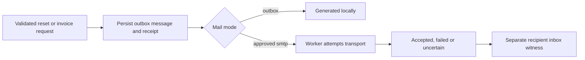

| State | What we can honestly say |
|---|---|
| Generated | The application created the message |
| Sending | A worker currently holds the delivery claim |
| Accepted | SMTP accepted the message; inbox arrival is not proved by this alone |
| Failed | The transport attempt failed |
| Unknown | An interruption left delivery uncertain; do not blindly resend |

Invoice send uses the saved registered customer address; the browser cannot substitute an arbitrary recipient. A new send for a canceled/superseded invoice is rejected. Exact replay still returns its original queued record.

The normal mail timer runs every second and handles bounded work. External transport runs outside the financial write transaction. Shutdown waits for an in-flight delivery before closing the database. Uncertain abandoned claims are not silently resent.

Default outbox mode keeps the application useful without external access. SMTP requires approved settings and the exact allowed recipient list. The explicit verification commands can send real email; ordinary automated checks do not.

### Print and Save as PDF

The authenticated print endpoint creates escaped HTML from the saved invoice. It checks role/ownership, uses restricted inline styling/handler permissions, and loads no remote assets. Draft/Canceled status remains visible. A customer can print only their own invoice.

The user uses the browser's **Print / Save as PDF** dialog. The baseline does not claim a stored server PDF library or a PDF attachment in invoice email.

The existing print evidence records actual Chromium PDFs for Draft, Confirmed and a 50-line maximum-amount case, with rendered inspection. See [P5 delivery and print](../evidence/P5_DELIVERY_AND_PRINT.md).

### Worker responsibilities

| Worker/process | Trigger | Responsibility |
|---|---|---|
| Billing worker | Persisted run creation/startup/recovery | Process saved run items with short transactions and progress |
| Mail worker | One-second normal-server timer | Deliver approved queued messages and preserve truthful outcomes |
| Lifecycle worker | Startup and ten-second normal-server timer | Apply due effective service events and expiry |
| Activation processing | Explicit internal process-due operation | Activate eligible future Confirmed agreements |

These run within the local Node application, not a separate Redis/queue service or distributed worker cluster.

## 23. Tests, evidence and performance

### What the different checks prove

| Check | Examples | What it does not prove alone |
|---|---|---|
| Lint | Configured code rules | Business correctness |
| Typecheck | Request/response type compatibility | Values arriving over HTTP are valid |
| Domain/calculation tests | Dates, amounts, tax, allocation | A real browser can finish the workflow |
| HTTP/database integration | Auth, records, constraints, rollback | Every layout is usable |
| Independent-process races | Signup, last discount use, billing overlap, payment allocation | Distributed production scale |
| Browser journeys | Real controls, server, SQLite, refresh and role denial | Every page under two seconds with thousands of rows |
| Print rendering | Actual generated PDF layout | Email inbox delivery |
| SMTP/inbox witnesses | Accepted transport and observed arrival | Every future message will arrive |
| Large-data benchmark | Defined dataset and timed API/rendered interactions | Only the recorded local desktop scope; not universal/mobile capacity |

### Test file map

| Files under `tests/` | Main subject |
|---|---|
| `validation.test.ts`, `auth.test.ts`, `reset.test.ts`, `security.test.ts` | Password/input rules, sessions, reset, authorization and safe requests |
| `database.test.ts`, `contention.test.ts` | Persistence, migrations, transactional reads/writes and competing processes |
| `performance-migration.test.ts` | Populated migration 11, order indexes and preservation of existing financial/teammate guards |
| `catalog.test.ts`, `calculation.test.ts` | Catalog configuration, exact money and calendar anchors |
| `subscriptions.test.ts` | Template independence, quote freezes, transitions, replay and ownership |
| `billing.test.ts`, `discount-money.test.ts` | Financial snapshots, rule boundaries, rounding, zero totals and usage |
| `billing-queue.test.ts`, `billing-workbench.test.ts` | Due backlog, runs, failed work, worker recovery and replacement |
| `payments.test.ts`, `lifecycle.test.ts` | Partial/full collection, concurrent allocation and effective service history |
| `finance.test.ts` | Filters, exact aggregates, current balances and role denial |
| `mail.test.ts`, `invoice-output.test.ts` | Outbox/transport states, safe output and send/print permissions |
| `e2e/*.spec.ts` | Identity, catalog, subscriptions, billing, collections/lifecycle and finance browser journeys |
| `ai-quote.test.ts`, `e2e/ai-quote.spec.ts` | Eleven focused suggestion/budget/review tests and four assisted/manual browser journeys with an injected provider |

### Isolation matters

Domain/API fixtures create fresh temporary SQLite files with synthetic users and an injectable clock. Supertest exercises Express rather than replacing business records with frontend mocks. Tests stop workers and close their databases afterward.

Playwright uses a unique temporary database, production assets, Chromium, one worker, zero retries and a separate server on port 3100. It refuses reuse of an existing server. The browser fixture does not use real SMTP or the normal `.env`.

### Run the checks

```powershell
npm run check
npx playwright install chromium
npm run test:e2e
```

`check` includes the production build; it does not include Playwright. Install Chromium when needed for the installed Playwright version. Real SMTP checks are separate intentional side effects, not part of this sequence.

### Existing evidence versus this documentation pass

The checked main's P9 evidence records lint, both TypeScript checks, **181 tests**, production build and **30/30** browser journeys. Three controlled real provider requests have separate live evidence; automated/browser AI tests inject a provider and never spend real API funds. The fresh checks for this documentation update appear below, separately from the release owner's observations.

| Documentation-pass check | Result |
|---|---|
| Locked dependency install | `npm ci` passed on Node 26.8.1 / npm 12.2.1 in an isolated checkout |
| Lint/typecheck/domain tests/build | `npm run check` passed lint, both typechecks, 181/181 tests and production build; test duration 70,155.5008 ms |
| Production browser journeys | `npm run test:e2e` passed 30/30 in 52.0 seconds against production assets and fresh temporary SQLite; AI provider injected, no live call |
| Markdown links, diagram syntax and formatting | 105 relative source links, 30 internal links, 50 tables and all 28 requirement rows checked; 12 Mermaid diagrams parsed/rendered and visually reviewed; whitespace check passed |
| Real provider calls / SMTP resend / new PDF rendering / large-data benchmark | Not run for this documentation-only change |

The fresh P9 build retains a **633.24 kB minified / 179.40 kB gzip** large-chunk warning. The warning remains a disclosed concern. Test-suite durations are not page-performance measurements.

Live generation, delivery, PDF-layout and benchmark claims refer to the existing evidence identified here; this documentation update makes no new provider, email or payment requests.

No lint, typecheck, domain/integration, build or browser stage failed in this update. The remaining build warning and unmeasured performance scopes are retained explicitly.

### Performance: the answer must stay precise

The brief requires **every page under two seconds with thousands of subscriptions**. The current ledger marks FIN-02 Verified for the recorded local desktop scope. The evidence combines a complete inventory with successful repeat verification of a corrected workload. It does **not** claim every sample in every run was below two seconds, a complete post-fix rerun, or large-data mobile proof.

Pages are imported eagerly rather than split into lazy route bundles. A large bundle warning is a known optimization concern, not a failed functional build and not itself a measured page latency. The traced queue bottleneck was SQL/request work; negligible font/frame waits and a short document load helped distinguish it from bundle delivery.

A defensible report records dataset counts/shape, hardware, server/database settings, exact build, cold/warm state, page/query/filter, timing boundaries, samples and every observed breach. API time and rendered interaction time are separate. The checked-in [P8 performance record](../evidence/P8_PERFORMANCE.md) provides these details and links preserved results.

### Large-data dataset: what was actually tested

The benchmark fixture is separate from the three-agreement November demo. It uses a fixed November 9 synthetic clock and retains real relational/financial constraints.

| Dataset component | Count / shape |
|---|---|
| Subscriptions | 10,000; 2,500 for each of daily/weekly/monthly/yearly |
| Stages | 500 Draft, 500 Quotation, 1,000 Confirmed, 6,500 Active, 1,500 Closed |
| Current finance active count | 6,400; excludes 100 TermEnded records despite their Active commercial stage |
| Customer accounts | 202; admin/staff are additional roles |
| Invoice revisions | 30,000: 6,000 Draft, 15,399 Confirmed, 7,701 Paid, 900 Canceled |
| Invoice lines | 60,000 |
| Positive payment allocations | 27,400 |
| Logical charges | 31,056: 30,000 invoiced, 1,000 paused waivers, 56 retryable failures |
| Lifecycle events | 2,600 |
| Discount applications | 30,000 |

Seventeen authenticated API prototypes establish valid commercial/financial shapes. The generator bulk-clones those checked shapes inside transactions with financial guards enabled. Payments invoke the real allocation triggers. It does not handwrite inconsistent Paid badges or replace business tables with mock JSON.

Both the application validator and an independent read-only Python audit check calendars, accepted prices, sums, rule allocations, cursor prefixes, payments, usage, pointers and SQLite integrity. The [dataset record](../evidence/P8_DATASET.md) reports exact lifetime billed/paid/debt totals. Those large-data totals are different from the November demo's month-scoped ₹4,188.80 / ₹3,088.80 / ₹1,100 witness.

The fixture has a compact catalog, two ordinary pricing patterns, one zero-total edge case and one historical billing run. Longer replacement histories and special races are covered by focused tests. It is representative synthetic evidence, not a claim that every possible customer workload was reproduced.

### How the benchmark tools connect

| File | Job |
|---|---|
| [benchmark-fixture.ts](../../server/benchmark-fixture.ts) | Create a new isolated seed; refuse overwrite; save adjacent manifest |
| [benchmark-data.ts](../../server/benchmark-data.ts) | Describe counts, accounts, IDs, clock and fixture manifest |
| [benchmark-validation.ts](../../server/benchmark-validation.ts) | Recompute/check domain facts after generation |
| [benchmark-server.ts](../../server/benchmark-server.ts) | Run the production app against a copied synthetic database and clock |
| [benchmark-pages.ts](../../server/benchmark-pages.ts) | Declare destination/role/state variants, API paths, controls and real readiness |
| [benchmark.ts](../../server/benchmark.ts) | Orchestrate server restarts, browser contexts, samples, concurrency and separate batch work |
| [verify-benchmark.py](../../scripts/verify-benchmark.py) | Independently audit raw SQLite facts without importing application code |
| [audit-benchmark-run.py](../../scripts/audit-benchmark-run.py) | Check recorded sample coverage, thresholds, completion and database integrity |
| [package-benchmark-evidence.py](../../scripts/package-benchmark-evidence.py) | Package preserved observations, redact sensitive token/password fields and calculate summaries without remeasurement |

### Reproduction commands

Install the normal dependencies and matching Chromium first. Allow at least 1.5 GB free disk for the seed and copies. The explicit output path below must be new:

```powershell
npm run build
npm run benchmark:seed -- --output=data/p8-example.sqlite
npx tsx server/benchmark-validation.ts data/p8-example.sqlite
python scripts/verify-benchmark.py data/p8-example.sqlite
npm run benchmark -- --manifest=data/p8-example.sqlite.manifest.json --samples=50 --label=release
```

The runner uses a separate local server on port 3004 by default, copies the database for runtime/batch activity and writes raw results under ignored `data/benchmark-*/results.json`. Audit the actual result path printed by the run:

```powershell
python scripts/audit-benchmark-run.py data/benchmark-<run>/results.json
```

Replace `<run>` with the actual directory name; do not type the placeholder literally. `--viewport=390x844` selects a narrow viewport, and `--only=pattern` selects a disclosed subset. A smaller smoke/subset run is not a complete release measurement.

### Measured environment and boundaries

The completed desktop run used `51342fa`; corrected queue measurements used `b362b75`. The release evidence keeps exact build/asset fingerprints. They ran on Ryzen 9 5900HX, 16 logical processors, about 16.48 GB reported RAM, Windows x64, Node 26.8.1, headless Chromium 156 and a 1440 × 1000 viewport. Starting SQLite was about 281 MB, with WAL, foreign keys, FULL synchronization and one-second busy timeout.

| Boundary | What the timer includes / excludes |
|---|---|
| Cold-server API | Complete GET and body read after process restart; server startup itself is outside request time |
| Warm API | Repeated authenticated request/body reads |
| Cold-browser page | New context and empty browser HTTP cache; server/OS filesystem caches are not flushed |
| Warm page | Role context reused after untimed preparation |
| Rendered readiness | Navigation through real data/useful controls, fonts ready and two animation frames |
| Search/filter/page/preview | Actual input, relevant debounce, response and rendered result |
| Batch | Acknowledgement and full job completion reported separately |

### Complete desktop run: successes and retained failure

The complete inventory covered 93 destination/role/state variants, 14 interactions and 115 distinct role/API paths. These include authorization-denial states as well as ordinary pages; 93 does not mean 93 separate business page designs.

| Boundary | Samples | Median ms | p95 ms | Maximum ms |
|---|---:|---:|---:|---:|
| Cold-server API | 115 | 14.320 | 297.404 | 1,069.249 |
| Warm API | 5,750 | 1.900 | 227.096 | 635.810 |
| Cold-browser page | 93 | 258.800 | 741.707 | **2,647.127** |
| Warm page | 4,650 | 116.100 | 499.496 | 1,283.574 |
| Input-to-render actions | 700 | 205.131 | 869.603 | 904.373 |
| Five-context navigation | 150 | 199.252 | 1,083.161 | 1,317.487 |

There were zero readiness/HTTP errors in that completed run, but the cold admin due-workbench page exceeded the literal two-second threshold. A good p95 does not hide that sample.

The five-context measurement used three workloads over ten rounds each. Its finance workload included three internal finance pages and two customer permission-denial pages; it was not five finance users.

### What was corrected, and what was repeated?

First smoke measurements had subscription/invoice list API times of 2,016.675 ms and 2,872.224 ms. Their queries scanned wide tables and sorted without matching order indexes. Migration 11 adds `(created_at DESC, id)` indexes for those lists. The upgrade regression checks preservation of existing records and teammate indexes/triggers.

The later 2,647.127 ms queue page breach was investigated separately. Diagnostics retained eleven queue breaches, including a 3,755.223 ms warm page. The correction starts from indexed canceled invoice IDs/failed charge IDs, checks current revision pointers, and applies the same scope/search/order/page rules. It changes selection work, not financial rules. Old/new responses matched 27 comparisons over nine scopes.

The corrected queue repeat covered three variants with 20 cold and 50 warm browser samples each, plus nine API paths. It had **zero errors and zero breaches**:

| Corrected boundary | Samples | p95 ms | Maximum ms |
|---|---:|---:|---:|
| Cold-server API | 9 | 150.171 | 150.171 |
| Warm API | 450 | 128.740 | 162.701 |
| Cold-browser page | 60 | 494.576 | 515.857 |
| Warm page | 150 | 381.347 | 416.717 |

### Batch throughput, preserved results and remaining limits

A separate 250-item run acknowledged in 38.555 ms and completed in 48,407.193 ms, with 250 persisted created results and no duplicate logical periods. All 126 concurrent finance GET probes returned 200 below two seconds. The 48.4-second batch completion is throughput evidence; it is not described as a page response time.

Seven preserved runs contain 20,922 observations. [P8_RESULTS.json](../evidence/P8_RESULTS.json) holds summaries/failures; [P8_RAW.json.gz](../evidence/P8_RAW.json.gz) retains sanitized observations, diagnostics and original completion states. Fifteen threshold entries include real API/page breaches and a harness readiness timeout. Read [P8_PERFORMANCE.md](../evidence/P8_PERFORMANCE.md) to distinguish them.

The later redundant full desktop repeat was interrupted at the user's request and stays labelled interrupted/running in the evidence. It recorded complete API samples and 43 of the 93 cold-page variants, plus their warm samples, without a recorded breach before stopping. It is not a completed final rerun. A new mixed operational supplement did not run. The large-data 390 px benchmark was canceled before execution; earlier mobile functional browser checks do not become mobile performance proof.

The accepted local desktop result therefore combines full inventory coverage with affected-path correction/repeat. Different hardware, WAN latency, more traffic, later code changes and unmeasured viewport combinations require new measurements. The fresh-start witness in [P8_STARTUP.json](../evidence/P8_STARTUP.json) separately records install/build/migration/seed and real protected browser navigation; it is not a load benchmark.

There is no checked-in GitHub Actions workflow on this main. Describe the commands as local verification, not an established hosted CI pipeline.

## 24. An evaluator walkthrough you can rehearse

### Launch the repeatable November story

```powershell
npm run build
npm run demo
```

Open [the isolated demo](http://localhost:3003). Every launch creates a fresh retained synthetic database; the business date is fixed to **9 November 2026** and clearly labelled. It never loads the normal `.env`, sends SMTP, or moves money.

| Role | Demo email | Password |
|---|---|---|
| Admin | `admin@brightloop.test` | `Brightloop!2026` |
| Staff | `staff@brightloop.test` | `Brightloop!2026` |
| A / Studio customer | `studio@brightloop.test` | `Brightloop!2026` |
| B / Shop customer | `shop@brightloop.test` | `Brightloop!2026` |
| C / Services customer | `services@brightloop.test` | `Brightloop!2026` |

The default demo is already settled for A. For a live collection demonstration, start a fresh fixture:

```powershell
npm run demo -- --settlement=unpaid
# Or begin after A's first receipt:
npm run demo -- --settlement=partial
# Optional alternative port:
npm run demo -- --port=3004
```

Stop with Ctrl+C. A settled demo is useful for explaining history; an unpaid/partial demo is useful for recording the remaining synthetic payments live.

### Suggested order and what to say

| Step | Show | Explain |
|---|---|---|
| 1 | Workspace and synthetic date banner | “This is a local synthetic fixture using our real database and rules.” |
| 2 | Product, Odoo variant, plan and template | “Configuration is reusable; the plan replaces the primary base price.” |
| 3 | A's agreement | “The customer, term, accepted price and stage history are saved.” |
| 4 | A's invoice | Walk through ₹3,120 − ₹312 + ₹280.80 = ₹3,088.80 |
| 5 | Saved batch run and due queue | “Each period has a durable outcome. Replay cannot create a second charge.” |
| 6 | Partial payment/history | “₹1,000 leaves ₹2,088.80 and the invoice stays Confirmed.” |
| 7 | Final payment/history | “The remaining amount settles it once; Paid means zero outstanding.” |
| 8 | Finance with November ranges | Reconcile 3 active, ₹4,188.80 billed, ₹3,088.80 cash, ₹1,100 debt |
| 9 | B's overdue invoice | “Due November 8; current demo date November 9.” |
| 10 | C's history | “October was really billed/paid; next bill November 15 is not due.” |
| 11 | Service page | Show accepted capabilities and effective-date explanation |
| 12 | Customer login and own print | Demonstrate ownership and absence of internal controls/private notes |
| 13 | Tests/evidence and limitations | Explain the scoped desktop performance proof, retained breaches, correction and unmeasured mobile case |
| Optional P9 | New quotation assistance with synthetic needs | Explicit request → Apply → server preview → review → Save Draft; show manual fallback without requiring a new paid call |

To demonstrate a live quote-to-active creation, use a fresh customer agreement through the normal Draft editor, issue, confirm and activate controls, then bill its due period. Do this after the fixed finance reconciliation, or use a separate fresh demo launch: adding another agreement changes the witness totals.

Do not force a real email send, record real money, or alter the normal database just to finish the rehearsal. Existing approved inbox witnesses are documented separately.

### How the teammates should prepare

One teammate can lead the commercial journey; the other can lead billing, finance and failure cases. Swap roles in a second rehearsal. Each person should be able to trace at least one action from UI → shared input → server guard → transaction → database → updated view.

Use genuine commits and reviewed work when discussing ownership. Both teammates should explain the code they present and acknowledge the actual contribution scope.

## 25. Evaluator questions and clear answers

### Product and architecture

**What problem does this solve?**

It connects recurring agreements, billing, receipts and reporting so staff can see what was promised, what should be billed, what has been paid and what remains overdue.

**Is it an Odoo module?**

No. SubTrack is our standalone React/Express/SQLite implementation of the supplied Brightloop problem. The repository name comes from the event context.

**Is the dashboard hardcoded?**

No. Lists and metrics read persisted SQLite records through server APIs. Fixtures are synthetic starting data. Creating a record or recording a payment changes persisted state and subsequent totals.

**Why this stack?**

TypeScript shares contracts across the browser/server. React provides reusable screens, Express handles APIs, and SQLite makes the required product runnable locally without a hosted service. We accepted the single-machine scaling tradeoff and test its transactional behavior.

**Why no WebSockets?**

The requirement is changing persisted data. Refresh after actions and bounded polling for active jobs meet the present workflow. We do not claim every page receives instant pushes.

**How would you move to a larger deployment?**

First measure the real bottlenecks. A later migration could introduce a server database, connection/worker management and deployment infrastructure, while preserving domain invariants and replay keys. That migration has not been implemented or validated here.

### Trust, identity and privacy

**Can someone make themselves admin by editing the request?**

No. Public signup accepts only allowed customer fields and fixes the role to customer. Staff creation is an admin-only route and fixes the new role to staff.

**Can a customer open another person's invoice URL?**

Server ownership checks reject inaccessible records. This is enforced for detail, history and print, not just the menu. Safe serializers omit internal fields.

**Why validate on both sides?**

Client validation helps the user quickly. Server validation is mandatory because requests can bypass the browser. Database constraints protect the final persisted state.

**Are passwords encrypted?**

They are salted and hashed with scrypt, not stored as reversible plaintext. Random login/reset tokens are stored as digests, with expiry and revocation rules.

**Does reset really email the user?**

Outbox mode only generates locally. Approved SMTP and actual recipient inbox evidence were verified separately and recorded. Automated tests do not send real messages.

### Pricing and billing

**Why don't plan and product prices double-charge?**

The plan replaces the primary catalog base price. The selected variant adjustment is added once per unit; optional add-ons have their own accepted lines.

**What if the catalog price changes after the quote?**

Draft editing explicitly reprices. An issued quotation and accepted contract preserve their saved commercial snapshot. Later catalog changes do not rewrite it.

**Why use integer paise?**

Money needs exact minor units and a stated rounding policy. BigInt intermediates and explicit allocation keep totals reproducible, including discounts spread across lines.

**When are taxes and discounts chosen?**

At invoice generation using the generation business date and current eligible rules. The resulting financial snapshot is then frozen. Confirm consumes the already-reserved use.

**What if two invoices want the last discount use?**

Reservation and invoice creation share an immediate transaction with capacity constraints. Only one can reserve that remaining use. The race is tested with independent processes.

**What prevents two workers billing the same month?**

The unique logical period identity, write transaction, persisted replay receipt and one-current-revision rules. A disabled button is only the first user-interface safeguard.

**What if a batch crashes halfway through?**

Completed item transactions remain committed, unfinished work remains persisted, and worker recovery can resume eligible stale/queued work. Failures remain visible and retries target failed periods.

**Why does a closed agreement still appear in the due queue?**

Closure stops future service; it does not erase an earlier owed period. Billing evaluates effective history rather than filtering only the current badge.

**Can staff change an incorrect invoice total?**

Generated totals are immutable. An eligible unpaid invoice can be canceled and explicitly replaced with a reviewed linked revision. Old history remains.

**Why can a zero invoice be Paid without a payment?**

Nothing is owed. Confirmation records zero-amount settlement without inventing a fake receipt.

### Collections, lifecycle and reporting

**Does recording a card payment charge a real card?**

No. Method is a classification of a receipt already received. There is no gateway or bank connection in the required implementation.

**What if the payment response is lost?**

The operation may already have committed. Retrying the exact reviewed submission key returns its saved result; a changed payload under that key is rejected. Check the saved invoice/history before starting a new intended receipt.

**Why is a partly paid invoice still Confirmed?**

Confirmed means collectible. Paid means its outstanding amount is zero. The balance and payment history explain partial collection.

**What if two staff collect against the same balance?**

Each transaction rechecks the current committed outstanding under the write lock. The second request cannot overpay based on a stale screen.

**Can you undo a payment?**

Not in this baseline. Payment facts are immutable; reversal/refund/correction UI is a disclosed limitation.

**Does pause erase the current bill or extend expiry?**

No. It applies at an eligible future original boundary, preserving decided periods and old debt. It does not change the original anchor or expiry.

**What does active mean in finance?**

Current Active-stage agreements inside their accepted term and before effective closure. Paused agreements with open terms are included and shown as a subset.

**Why do invoice and payment filters differ?**

Billing and cash happen on different dates. A receipt can arrive this month for an older invoice. Outstanding remains the current balance of the selected invoice cohort.

**Can you prove every page is under two seconds with thousands of subscriptions?**

We have measured local desktop evidence on 10,000 subscriptions. The full inventory had one real cold queue breach; we traced and corrected it, then repeated all three affected queue variants without breaches. We retain the original failures and interrupted later repeat. The ledger marks FIN-02 Verified for that documented desktop scope. We do not claim a complete post-fix rerun, untested hardware/traffic or large-data mobile compliance.

**Where is AI?**

P9 implements optional quotation assistance in New quotation for admin/staff. It proposes existing catalog selections and quantities, then normal server calculation and explicit human review/save apply. It cannot choose customer identity, authoritative amounts, invoice/payment status or execute financial actions. Manual entry remains complete without a key; section 29 has the full flow and evidence.

**What would you work on next?**

Finish the organizer/checklist handoff under the team's actual submission instructions, preserve the scoped performance evidence, and measure any later code/environment changes. Additional mobile load proof remains unmeasured. Optional enhancements must preserve the verified business rules.

## 26. Requirement-by-requirement map

The brief has **28 tracked IDs**. IDs are the team's labels, not organizer numbering. The status column below reports the checked main ledger. Read [REQUIREMENTS.md](../REQUIREMENTS.md) for the authoritative wording and [IMPLEMENTATION_STATUS.md](../IMPLEMENTATION_STATUS.md) for full evidence history.

| ID | Plain requirement | Implementation / proof entry point | Main ledger |
|---|---|---|---|
| AUTH-01 | One customer account per email | `server/identity.ts`; auth/database/race tests | Verified |
| AUTH-02 | Exact required password strength | `shared/validation.ts`; validation and identity browser tests | Verified |
| AUTH-03 | Registered-email reset link | `server/identity.ts`, `server/mail.ts`; reset tests and P1 inbox witness | Verified |
| AUTH-04 | Distinct roles and own customer portal | Server guards/serializers; role, ownership, output and browser tests | Verified |
| AUTH-05 | Admin alone adds staff | Identity routes; auth/identity browser tests | Verified |
| CAT-01 | Product name/type/sales/cost/notes | `server/catalog.ts`; catalog API/browser tests | Verified |
| CAT-02 | Configurable variant adjustments | Catalog and server preview; configured Odoo example | Verified |
| PLAN-01 | Price and four recurring intervals | Catalog/calendar code; catalog/calculation tests | Verified |
| PLAN-02 | Minimum quantity and availability | Subscription eligibility; catalog/subscription tests | Verified |
| PLAN-03 | Enforced plan lifecycle permissions | `server/lifecycle.ts`; lifecycle/race/browser tests | Verified |
| QUOTE-01 | Reusable lines/plan/validity templates | Catalog/subscription code; template independence tests | Verified |
| SUB-01 | Number/customer/plan/dates/terms | Subscription records, snapshots and tests | Verified |
| SUB-02 | Explainable line prices/taxes/amounts | Server previews/snapshots; calculation/subscription tests | Verified |
| SUB-03 | Draft → Quotation → Confirmed → Active → Closed | Subscription/lifecycle transitions and history | Verified |
| SUB-04 | Shared internal subscription state | Persisted internal lists/detail and reload tests | Verified |
| BILL-01 | Batch prefilled invoices for due subscriptions | Workbench; 260-record 250+10 run witness | Verified |
| BILL-02 | Automatic configured taxes | `server/billing.ts`, `server/money.ts`; exact A/B totals | Verified |
| BILL-03 | Confirm/cancel/send/print | Billing/output; P5 controlled inbox and rendered PDFs | Verified |
| BILL-04 | Draft → Confirmed → Paid | Invoice/payment constraints; partial and zero-total tests | Verified |
| BILL-05 | No duplicate or silently skipped bills | Logical periods, effective history, rollback/replay/race tests | Verified |
| DISC-01 | Admin alone creates discounts | Billing guards; denied direct requests/browser tests | Verified |
| DISC-02 | Kind/threshold/date/max-use bounds | Billing/discount-money tests, last-use race | Verified |
| DISC-03 | Product or subscription scope | Eligibility/allocation code and tests | Verified |
| DISC-04 | Automatic eligible use and expiry/exhaustion | Reservation/consumption snapshots; replay/boundary tests | Verified |
| PAY-01 | Correct invoice-linked method/amount/date/note | `server/payments.ts`; payment and concurrency tests | Verified |
| PAY-02 | Paid/outstanding/overdue truthfully | Invoice balances, history, finance and browser tests | Verified |
| FIN-01 | Filtered summary and financial follow-up | `server/finance.ts`; eight finance tests and browser drilldowns | Verified |
| FIN-02 | Every page under two seconds at thousands scale | 10,000-subscription desktop inventory, retained breaches, corrected queue repeats; mobile unmeasured | Verified, scoped local desktop |

Required event expectations also include dynamic data, responsive consistency, validation, clear navigation and genuine team participation. [HACKATHON_CONSTRAINTS.md](../HACKATHON_CONSTRAINTS.md) maps those. Optional improvements do not replace either baseline.

## 27. Troubleshooting and making changes safely

### Common local problems

| Symptom | Likely check / safe next step |
|---|---|
| `node:sqlite` cannot load | Check Node version; requirement is 24+ |
| Dependencies missing | Run `npm ci` from the repository root |
| Production says build is missing | Run `npm run build` before `npm start`, demo or browser proof |
| Port already in use | Stop the intended old process or choose a consistent free port/origin; demo accepts `--port` |
| Origin/CSRF denied | Open the configured origin; refresh session; do not bypass protection |
| Demo users cannot sign in | Confirm you seeded the intended database/environment; do not overwrite existing users |
| Another user's record gives 404/403 | Check role/ownership; denial may be correct |
| Configuration update conflicts | Another version was saved; reload/review instead of overwriting it |
| Payment review is now too large | Another receipt changed balance; inspect latest history and review the corrected amount |
| Database busy | Let the concurrent write finish and retry; keep DB on local disk |
| Send shows Generated | Outbox only, or awaiting worker; generation is not inbox delivery |
| SMTP configuration is incomplete | Run `npm run mail:check`; it reports missing setting names |
| Send shows Unknown | Inspect the original delivery before intentionally requesting another notice |
| Playwright browser executable missing | Install matching Chromium with `npx playwright install chromium` |
| Browser tests cannot start port 3100 | Stop the conflicting process; tests intentionally refuse server reuse |
| Finance differs from example | Check invoice/payment ranges, customer filter, settlement mode and any extra records you created |
| No next invoice for C | Before November 15 in the fixed demo, that is correct |
| Current Closed/Paused record still has old debt | Inspect the period dates/history; service closure does not erase debt |

Do not delete a database to solve an unexplained issue. Stop and inspect the environment/path first. There is no documented destructive reset command. For a clean rehearsal, use the fresh isolated demo launcher.

### A safe feature-change path

1. Check `git status`, branch and teammate ownership before editing.
2. Identify the requirement/policy affected. Read its shared contract and tests.
3. Change shared inputs/DTOs when necessary, then server rules/schema, then the connected screen.
4. Preserve authorization, historical snapshots, exact arithmetic and replay behavior.
5. Add focused meaningful checks for changed domain behavior.
6. Run affected tests, then the aggregate commands and relevant browser journey.
7. Update evidence honestly; a planned test is not a passed test.
8. Fetch remote state before integration. Use focused commits; do not force-push unknown work.

### Debugging an action

Use the browser Network panel to identify the API path, status and safe request ID. Follow that route in its server feature module, then its shared schema and SQL transaction. Avoid printing credentials, raw tokens or private customer content while investigating.

If a request times out, check persisted results first. A lost response and a failed transaction are different situations. Reuse the existing reviewed submission key for an exact retry; do not manufacture a new receipt accidentally.

## 28. Glossary and further reading

| Word | Simple meaning in this repo |
|---|---|
| API | The server interface the browser calls |
| Endpoint/route | One address and method such as `POST /api/invoices/:id/payments` |
| DTO | The response shape sent to the browser, with only permitted fields |
| Schema | Allowed field/type rules; can mean Zod input schema or database structure |
| Migration | A versioned database structure change |
| Foreign key | A database reference to another stored record |
| Transaction | A group of changes that commits together or rolls back |
| Atomic | All-or-nothing behavior |
| Snapshot | Saved historical terms/amounts that later catalog edits cannot rewrite |
| Idempotency | Exact repeated intended submission does not repeat the business effect |
| Version | Record revision number used to detect stale edits |
| Logical charge | One subscription period's financial identity across invoice revisions |
| Revision | A historical/successor invoice for the same logical charge |
| Cursor | Saved position of next unprocessed original billing period |
| Lease | Temporary worker ownership used for safe recovery |
| Cadence | Daily, weekly, monthly or yearly schedule |
| Anchor | Original start date used to calculate recurring boundaries |
| Minor unit | Paisa for INR |
| Basis point | One hundredth of one percentage point |
| CSRF | A protection against another site causing signed-in state changes |
| Ownership | The rule that a customer can access only their own records |
| Outbox | Persisted messages waiting for or representing email generation/delivery |
| Fixture | Controlled synthetic data for a test or demo |
| E2E | End-to-end check through the real browser and connected server/database |
| Production build | Compiled/bundled application assets; does not itself mean production ready |

### Which document answers which question?

| Document | Use it for |
|---|---|
| [Root README](../../README.md) | Concise startup and command reference |
| [Requirements](../REQUIREMENTS.md) | What the supplied four-page brief actually requires |
| [Hackathon constraints](../HACKATHON_CONSTRAINTS.md) | Standing event expectations |
| [Decisions](../DECISIONS.md) | Adopted business policies where the brief is silent |
| [Implementation ledger](../IMPLEMENTATION_STATUS.md) | Current requirement results and executed gate history |
| [API contract](../API_CONTRACT.md) | Inputs, outputs and server/browser agreements |
| [Domain and edge cases](../DOMAIN_AND_EDGE_CASES.md) | Failure/boundary cases worth understanding |
| [Roadmap](../ROADMAP.md) | Ordered feature gates and pending work |
| [Execution blueprint](../EXECUTION_BLUEPRINT.md) | Planning guidance; suggested stack/timing are not proof of current implementation |
| [Demo and proof](../DEMO_AND_PROOF.md) | Reproducible numerical witnesses |
| [Judge walkthrough](../JUDGE_WALKTHROUGH.md) | Presentation order and evidence points |
| [P8 dataset](../evidence/P8_DATASET.md), [P8 performance](../evidence/P8_PERFORMANCE.md) | Large-data shape, measurements, corrected bottlenecks, failures and limits |
| [Baseline and enhancements](../BASELINE_AND_ENHANCEMENTS.md) | Required scope versus optional improvements |
| [Optional AI](../OPTIONAL_AI.md), [P9 verification](../evidence/P9_VERIFICATION.md) | Implemented suggestion contract, review/privacy/budget safeguards, real synthetic evaluation and limits |
| [Research](../RESEARCH.md) | Historical context; subordinate to current supplied requirements |
| [Design context](../../DESIGN.md), [UX contract](../../UX-CONTRACT.md) | Interface style and shared interaction behavior |

When documents disagree, follow the authority order in [AGENTS.md](../../AGENTS.md): newest explicit clarification, actual brief, standing constraints, recorded team decisions, then planning/research. For claims about what works now, inspect the actual code and latest executed evidence. Explain both the implemented rule and its practical limit.

## 29. P9: AI-assisted quotation preparation

P9 is implemented and verified as an optional helper inside **New quotation**. It reduces manual catalog selection by turning a short description into a reviewable proposal. The complete manual quotation form still works if AI is disabled, unavailable or out of allowance.

### Follow one assisted quotation

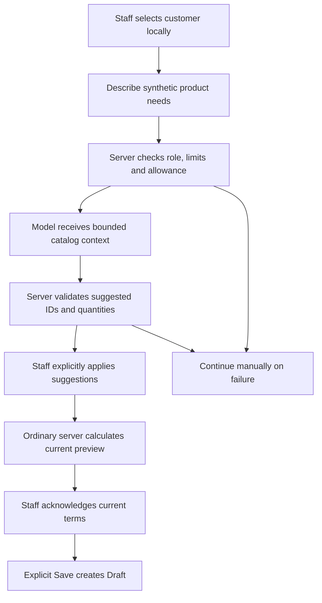

1. Admin/staff opens `/subscriptions/new` and chooses the customer using the normal form. The model does not choose that identity.
2. Staff describes synthetic needs, such as two Odoo-variant Business Software units, without personal information.
3. One explicit request goes to `POST /api/ai/quote-proposals`. Authentication and permission checks happen before catalog retrieval or provider transport.
4. The server reserves allowance and sends a bounded catalog subset through the Responses API. The release fixes the model to `gpt-4.1-mini`, uses strict Structured Outputs, supplies no tools and sets `store:false`.
5. The response is checked again for allowed fields, real catalog IDs, variant ownership, whole quantities, duplicate products and valid dates. Unsupported/ambiguous requests can return clarification rather than invented choices.
6. The suggestion appears for review. **Apply** changes the local form; a template-only suggestion loads the template's real stored lines/validity.
7. Normal `/api/subscriptions/preview` calculates prices and estimates using server rules. Staff acknowledges this current preview and explicitly saves Draft.
8. Issue, confirm, activate, bill, collect and send remain separate ordinary actions. AI has no authority to execute them.

The model may propose a plan/template, existing product/variant IDs, quantities and an optional requested start date, plus up to five clarification questions. It may not supply authoritative prices, tax, discount, total, customer identity, roles, status or executable commands.

### How AI stays connected to the ordinary system

| Component | Responsibility |
|---|---|
| `src/QuoteAssist.tsx` | Status/disclosure, request, suggestion review, explicit Apply and manual continuation |
| `src/Subscriptions.tsx` | Keep ordinary form fields, get current preview, require acknowledgement and save through existing route |
| `shared/ai-quote.ts` | Strict request/proposal schemas and response/review types |
| `server/ai-quote.ts` | Authorization, bounded context, persisted reservation, one provider request and output validation |
| `server/ai-quote-review.ts` | Bind the reviewed current preview to actor/customer/proposal/expiry |
| `server/ai-quote-schema.ts` | Migration 12: request ledger, proposals and review receipts |
| `server/subscriptions.ts` | Ordinary deterministic calculation and idempotent Draft creation |

The model's JSON format is called `quote-proposal-v1`. The request body is only `{customerId,request}`; the selected customer ID is used server-side for authorization/binding and is excluded from provider context. A successful response includes proposal ID, expiry, allowed display labels and proposed fields. A proposal request persists AI bookkeeping, not a subscription, invoice or payment.

### Human review is enforced on the server

A proposal belongs to one actor and customer and expires after 15 minutes. A fresh preview returns an opaque `reviewHash`, stored server-side against the proposal and calculated commercial terms. Saving an assisted Draft requires that current receipt.

If the customer changes, the proposal binding fails. If fields, prices or policies changed since review, fresh creation returns `409 AI_REVIEW_CHANGED`; the form remains available for re-preview and acknowledgement. Unknown/archived choices fail normal validation. Generated line IDs are excluded from the comparison so equivalent recalculations do not conflict for an irrelevant identifier change.

Lost-response replay is different: an existing successful ordinary create key is resolved before AI-expiry/review checks. An unchanged commercial payload returns its original Draft, even after a newer preview or proposal expiry. Changing commercial fields under that key still conflicts. This preserves the same duplicate protection used by manual creation.

### Privacy and limits

| Control | Implemented behavior |
|---|---|
| Eligible users | Admin/staff only; customer APIs denied before transport |
| Request text | 3–1,000 characters; use synthetic needs without personal information |
| Catalog context | At most 20 active plans, 30 products, 100 variants and 20 templates, further filtered for included relationships |
| Allowed catalog facts | IDs, names, types, versions and relevant eligibility metadata |
| Excluded server facts | Customer identity/email, selling/cost prices, variant price adjustments, internal notes and payment history |
| Context/request bound | Instructions plus request/catalog ≤20 KiB UTF-8; full request JSON ≤24 KiB |
| Output | At most 800 tokens, ten lines and five short clarifications; line quantities 1–10,000 |
| Provider deadline | Eight seconds maximum; no automatic retry or repair loop |
| Per-user controls | One request in flight and five requests per 15 minutes |
| Model failure | Preserve entered fields; Continue manually removes AI binding |
| Retention wording | `store:false` is used; it does not establish zero provider retention |

The context subset can omit valid catalog choices. Manual selection remains the complete path. Rejecting email-like text and the selected customer's name helps with privacy but is not a general personal-data detector. Free text and catalog names can contain personal data, so staff must follow the synthetic-input disclosure.

There is no separate global request-rate cap. The fixed release model is not silently substituted if unavailable; the manual path remains usable. Its release evidence records availability and a deprecation notice; future model availability requires a new check rather than a promise in this guide.

### Spending protection and concurrency

AI defaults off in `.env.example`. Enablement requires the existing private server key, `AI_QUOTE_ENABLED=true` and an explicitly approved positive `AI_QUOTE_BUDGET_USD` no greater than $5. This describes implemented controls, not permission to provision a new key or spend more.

Before dispatch, an immediate SQLite transaction reserves **$0.02**, stored as 20,000 integer micro-USD. Known returned usage reconciles to the release's configured token-accounting formula. Unknown, timeout or interrupted outcomes retain the full reservation because the application cannot prove that no usage happened. The ledger survives process restart.

All users of one application database share that allowance atomically. This is not a provider-project or cross-database spending cap; cloning/resetting the ledger or enabling another database must not be used to extend approval. No JavaScript mutex library is needed: the transaction obtains the SQLite write lock for the final allowance/in-flight decision.

The approved release evaluation used **$0.001075** of application-accounted allowance across three requests. The recorded remaining normal-app cap is **$4.998925**, keeping it within the approved $5 total. These numbers are application accounting from usage, not a provider billing statement or a current-price guarantee.

### What has actually been verified?

| Evidence | Recorded observation |
|---|---|
| Live known request | Two Odoo-variant units produced allowed selections; normal server preview calculated ₹3,120 subtotal |
| Explicit save/replay | No business record before Save; one Draft added; exact retry returned it; invoices/payments unchanged |
| Unsupported/ambiguous requests | Zero proposed lines and clarification questions |
| Live generation latency | 3,735 ms, 3,942 ms and 999 ms; optional generation is separate from ordinary page rendering |
| Focused automated coverage | Eleven tests covering authorization/privacy, strict output, fallback, budget concurrency, binding/review and replay |
| Browser coverage | Four assisted/manual journeys added to 26 existing journeys; provider injected, no real key/calls |
| Changed-form desktop measurement | Three changed variants on the 10,000-subscription fixture: 150 warm + three cold navigations, zero errors/breaches, 289.1794 ms maximum |
| Runtime witness | Normal compiled startup, schema 12, protected new-draft navigation/reload and enabled approved configuration |

See [P9_VERIFICATION.md](../evidence/P9_VERIFICATION.md), [live evaluation](../evidence/P9_LIVE.json), [independent evaluation audit](../evidence/P9_EVALUATION_AUDIT.json), [form measurements](../evidence/P9_FORM_PERFORMANCE.json) and [runtime witness](../evidence/P9_RUNTIME.json). The complete implemented policy is [OPTIONAL_AI.md](../OPTIONAL_AI.md).

The form timing is affected-path desktop verification. It does not replace the P8 full-inventory evidence or create a mobile performance claim. The optional model operation can take longer than two seconds; ordinary manual page readiness and financial operations do not depend on that call.

### A simple evaluator answer

“Our AI helps staff select existing catalog items for a quotation. It cannot choose the customer or set financial values; the server calculates those, and staff review and save explicitly. If the model fails, the same form works manually, with its existing data and normal financial safeguards.”
